# FundTogether database class diagram

This diagram shows the 17 MongoDB collections registered by the current Mongoose models. Each collection gets an `_id`, `createdAt`, and `updatedAt` automatically. These fields are omitted from the boxes. A `?` marks a field that can be absent or null. The embedded classes live inside their parent documents.

Solid association arrows follow Mongoose `ObjectId` references. The multiplicities describe the schema, including optional references and unique indexes. MongoDB does not automatically check that a referenced document exists.

```mermaid
classDiagram
    direction LR

    class User["User (users)"] {
        String displayName
        String email
        String passwordHash
        String phone
        UserRole role
        Boolean isActive
        Number credentialVersion
    }

    class Session["Session (sessions)"] {
        String tokenHash
        ObjectId userId
        Date expiresAt
        Number credentialVersion
    }

    class PasswordReset["PasswordReset (password_resets)"] {
        ObjectId userId
        String tokenHash
        String kind?
        Date expiresAt?
    }

    class Business["Business (businesses)"] {
        ObjectId ownerId
        Number onboardingVersion
        String officialName
        BusinessType businessType
        BusinessSector sector
        BusinessSize size
        Number establishedYear
        String operatingHistory?
        Number employeeCount
        String division
        String district
        String address
        String description
        String website?
        String businessEmail
        String contactPhone
        VerificationStatus verificationStatus
        Date verifiedAt?
        String rejectionReason?
        Date deletedAt?
    }

    class VerificationDocument["VerificationDocument (documents)"] {
        ObjectId businessId
        ObjectId ownerId
        DocumentType type
        String storageKey
        String originalName
        String mimeType
        Number sizeBytes
        DocumentStatus status
        Boolean isCurrent
        Number slot
        ObjectId replacesDocumentId?
        String reviewNote?
        Date deletedAt?
    }

    class BusinessApplication["BusinessApplication (business_applications)"] {
        ObjectId businessId
        ObjectId ownerId
        Number round
        ApplicationStatus status
        List~ObjectId~ checklist
        Mixed profileSnapshot
        Date submittedAt
        ReviewDecision decision?
        String decisionReason?
        ObjectId decidedBy?
        Date decidedAt?
    }

    class DocumentReview["DocumentReview (document_reviews)"] {
        ObjectId documentId
        ObjectId applicationId
        ObjectId reviewerId
        DocumentReviewDecision decision
        String note?
    }

    class Campaign["Campaign (campaigns)"] {
        ObjectId businessId
        ObjectId ownerId?
        String title
        String description
        String purpose
        String useOfFunds
        Number fundingTarget
        Number unitPrice
        Number totalUnits
        Number remainingUnits
        Number durationDays
        Date startsAt?
        Date endsAt?
        Date firstInvestmentAt?
        CampaignStatus status
        Number version
        CampaignBusinessSnapshot businessSnapshot?
        Date deletedAt?
    }

    class CampaignBusinessSnapshot {
        <<embedded>>
        String name
        BusinessSector sector
        String division
        String district
    }

    class CampaignReview["CampaignReview (campaign_reviews)"] {
        ObjectId campaignId
        Number version
        ObjectId reviewerId
        ReviewDecision decision
        String feedback?
    }

    class CampaignRevision["CampaignRevision (campaign_revisions)"] {
        ObjectId campaignId
        Number version
        Mixed snapshot
        Date submittedAt
        List~String~ changedFields
    }

    class Watchlist["Watchlist (watchlists)"] {
        ObjectId investorId
        ObjectId campaignId
    }

    class Wallet["Wallet (wallets)"] {
        ObjectId userId
        Number balance
    }

    class Investment["Investment (investments)"] {
        ObjectId investorId
        ObjectId campaignId
        Number units
        Number unitPriceAtPurchase
        Number totalCost
        String receiptNumber
        String idempotencyKey
        InvestmentStatus status
    }

    class Transaction["Transaction (transactions)"] {
        ObjectId walletId
        ObjectId userId
        TransactionType type
        Number amount
        Number balanceAfter
        ObjectId investmentId?
    }

    class AnalyticsReport["AnalyticsReport (analytics_reports)"] {
        ObjectId ownerId
        ObjectId businessId
        ObjectId campaignId?
        Date periodFrom
        Date periodTo
        Mixed metrics
        String metricsHash
        AnalyticsInsights insights?
        String model
        String promptVersion
        AnalyticsReportStatus status
        Date generatedAt
    }

    class AnalyticsInsights {
        <<embedded>>
        String summary
        List~String~ highlights
        List~String~ concerns
        List~String~ suggestions
    }

    class Notification["Notification (notifications)"] {
        ObjectId recipientId
        NotificationType type
        String title
        String message
        String link
        String entityType
        ObjectId entityId
        Date readAt?
    }

    class AuditEvent["AuditEvent (audit_events)"] {
        ObjectId actorId?
        String actorRole
        AuditAction action
        String entityType
        ObjectId entityId
        String reason?
        Mixed changes?
    }

    Session "0..*" --> "1" User : userId
    PasswordReset "0..1" --> "1" User : userId
    Business "0..*" --> "1" User : ownerId
    VerificationDocument "0..*" --> "1" Business : businessId
    VerificationDocument "0..*" --> "1" User : ownerId
    VerificationDocument "0..*" --> "0..1" VerificationDocument : replacesDocumentId
    BusinessApplication "0..*" --> "1" Business : businessId
    BusinessApplication "0..*" --> "1" User : ownerId
    BusinessApplication "0..*" --> "0..1" User : decidedBy
    BusinessApplication "0..*" --> "0..*" VerificationDocument : checklist
    DocumentReview "0..*" --> "1" VerificationDocument : documentId
    DocumentReview "0..*" --> "1" BusinessApplication : applicationId
    DocumentReview "0..*" --> "1" User : reviewerId

    Campaign "0..*" --> "1" Business : businessId
    Campaign "0..*" --> "0..1" User : ownerId
    Campaign "1" *-- "0..1" CampaignBusinessSnapshot : businessSnapshot
    CampaignReview "0..*" --> "1" Campaign : campaignId
    CampaignReview "0..*" --> "1" User : reviewerId
    CampaignRevision "0..*" --> "1" Campaign : campaignId
    CampaignReview ..> CampaignRevision : matches campaignId and version

    Watchlist "0..*" --> "1" User : investorId
    Watchlist "0..*" --> "1" Campaign : campaignId
    Wallet "0..1" --> "1" User : userId
    Investment "0..*" --> "1" User : investorId
    Investment "0..*" --> "1" Campaign : campaignId
    Transaction "0..*" --> "1" Wallet : walletId
    Transaction "0..*" --> "1" User : userId
    Transaction "0..1" --> "0..1" Investment : investmentId

    AnalyticsReport "0..*" --> "1" User : ownerId
    AnalyticsReport "0..*" --> "1" Business : businessId
    AnalyticsReport "0..*" --> "0..1" Campaign : campaignId
    AnalyticsReport "1" *-- "0..1" AnalyticsInsights : insights
    Notification "0..*" --> "1" User : recipientId
    AuditEvent "0..*" --> "0..1" User : actorId
```

## Constraints that affect the relationships

| Collection | Constraint |
| --- | --- |
| `users` | A unique index protects normalized email addresses. `role` is `business_owner`, `investor`, or `admin`. |
| `sessions`, `password_resets` | Token hashes are unique within each collection. Sessions expire via a TTL index. `password_resets.userId` is unique. Current recovery records use `kind: recovery_code` and have no expiry date. The TTL index only applies to records with an expiry date, such as legacy email reset records. |
| `businesses` | A partial unique index permits one unarchived profile per owner. Archived profiles explain the `0..*` multiplicity shown for all records. |
| `documents` | A partial unique index protects the current, unarchived `(businessId, type, slot)`. A replacement points to the previous document. File contents are stored privately outside MongoDB. |
| `business_applications` | `(businessId, round)` is unique. The checklist references the documents submitted in that round. `profileSnapshot` stores a copy of the submitted profile. |
| `campaigns`, `campaign_revisions` | The business snapshot is optional and embedded. Campaign search indexes the title, description, and snapshot business name. Revision snapshots are immutable and unique per `(campaignId, version)`. A review’s version can be matched to a revision through those fields. |
| `watchlists`, `wallets` | A watchlist entry is unique per `(investorId, campaignId)`. Each user can have at most one wallet. |
| `investments`, `transactions` | Receipt numbers and `(investorId, idempotencyKey)` are unique. Each wallet allows one starter credit. An investment debit requires an investment reference, and a partial unique index limits each investment to one ledger entry carrying its ID. Amounts are stored as whole virtual taka. |
| `analytics_reports` | A generated report requires embedded `insights`. A failed report may omit them. Reports can cover an entire business or one campaign. |
| `notifications`, `audit_events` | `entityType` and `entityId` identify different kinds of records. These fields have no single Mongoose reference target. A system audit event can omit `actorId`. |

## Source

- [Registered Mongoose models](../server/src/database/model-definitions.ts)
- [Enums and status values](../server/src/common/enums.ts)
- [Database migration and verification commands](../README.md#database-migration-demo-seed-and-verification)
