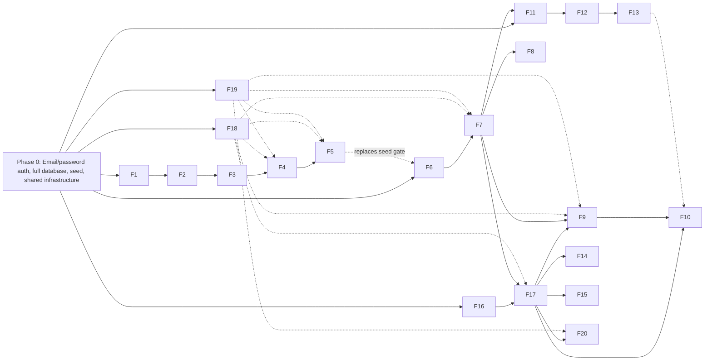

# FundTogether — Final Feature Plan and Build Order

**Course:** CSE470 · **Team:** four members · **Version:** 1.0 — 17 November 2026
**Companion to:** [FundTogether Project Specification.md](./FundTogether%20Project%20Specification.md)

> **Status:** This is the agreed **delivery plan**, not a progress report. As of 17 November 2026, the MVC structure is in place: Mongoose models for users, businesses and campaigns; working CRUD APIs for business profiles (most of F1) and campaign drafts (most of F6); and the business profile page connected to the API. Authentication, and therefore ownership checks, is not built yet, so **F1 and F6 are not complete**. The other React screens are still prototypes without API integration, and the remaining 18 features have not been started.

> **Decisions:** The policy choices this plan depends on are recorded in Section 8.1. Feature sections apply them directly. Only the items in Section 8.2 are still open.

> **Simulation boundary:** Every balance, unit, purchase and report in FundTogether is **virtual**. No real money, payment gateway, securities or returns are involved. UI text, API responses and AI output must never suggest otherwise.

---

## 1. Counting rules

Here is how we decide what counts as a feature:

1. **Each feature must depend on the database.** It must perform meaningful MongoDB reads and/or writes that survive a refresh or server restart.
2. **Authentication is not a feature.** Email/password sign-up and sign-in, password reset, sessions, role onboarding and guards are **shared infrastructure** (Section 3).
3. **CRUD operations, single screens and calculations are not separate features.** For example, create, read, update and delete for a campaign draft together make up **one** feature.
4. **A read-only feature counts only if** changing the underlying records changes what it shows. It must not be a static page.
5. **A feature is done only when** UI, API, validation, permissions and persistence all work together (Section 7).

> **Granularity risk:** Some pairs are separate features because they have different users, queries and purposes: marketplace vs due-diligence view, portfolio vs history, and owner analytics vs platform reports. Confirm with the faculty that this granularity is acceptable. If they count a whole module as one feature, database access alone will not split it.

---

## 2. The 20 features at a glance

| # | Feature | Member | Phase | Main collections |
|---|---|---|---|---|
| F1 | Business Profile and Classification | 1 | 1 | `businesses` |
| F2 | Verification Document Management | 1 | 2 | `documents` + file storage |
| F3 | Business Application Submission and Eligibility Checks | 1 | 2 | `business_applications` |
| F4 | Document Review and Correction Workflow | 1 | 3 | `document_reviews`, `documents` |
| F5 | Business Approval and Rejection | 1 | 3 | `businesses`, `business_applications` |
| F6 | Campaign Draft Management | 2 | 1 | `campaigns` |
| F7 | Campaign Review and Publication | 2 | 2 | `campaigns`, `campaign_reviews` |
| F8 | Campaign Revision and Resubmission | 2 | 3 | `campaign_revisions` |
| F9 | Campaign Lifecycle Management | 2 | 3 | `campaigns` |
| F10 | Business Analytics and AI Insights | 2 | 4 | `analytics_reports` (+ reads) |
| F11 | Marketplace Search and Filtering | 3 | 1 | `campaigns` (read) |
| F12 | Campaign and Business Due-Diligence View | 3 | 2 | `campaigns`, `businesses`, `investments` (read) |
| F13 | Campaign Watchlist | 3 | 2 | `watchlists` |
| F14 | Investor Portfolio | 3 | 3 | `investments` (aggregate) |
| F15 | Investment History and Receipts | 3 | 4 | `investments`, `transactions` |
| F16 | Virtual Wallet and Ledger | 4 | 1 | `wallets`, `transactions` |
| F17 | Simulated Investment Processing | 4 | 3 | `investments`, `wallets`, `transactions`, `campaigns` |
| F18 | Persistent Notifications | 4 | 2 | `notifications` |
| F19 | Administrative Audit Trail | 4 | 1 | `audit_events` |
| F20 | Platform Administration Reports | 4 | 4 | all (aggregate) |

**Load per member and phase** (each member owns one or two features per phase):

| Member | Phase 0 (shared) | Phase 1 | Phase 2 | Phase 3 | Phase 4 |
|---|---|---|---|---|---|
| **1 — Business onboarding & verification** | Email/password auth, password reset, and sessions | F1 | F2, F3 | F4, F5 | Integration & demo data |
| **2 — Campaign management** | Roles, onboarding, guards | F6 | F7 | F8, F9 | F10 |
| **3 — Investor discovery & records** | React shell, routing, API client | F11 | F12, F13 | F14 | F15 |
| **4 — Transactions & oversight** | Seed script, storage helper, error envelope | F16, F19 | F18 | F17 | F20 |

---

## 3. Shared infrastructure (Phase 0 — not counted)

Phase 0 delivers shared infrastructure and the complete MongoDB schema for all 20 features. Feature APIs, screens, and business workflows follow the phases in Section 6.2.

| Item | Implementation | Owner |
|---|---|---|
| **Email/password auth** | Business owners and investors sign up with a normalized email address and password. The server stores an Argon2id password hash and authenticates all three roles through `POST /api/auth/login`. Admin accounts are seeded. Email verification is deferred. | M1 |
| **Password reset** | Show a one-time recovery code on sign-up. A signed-in user can replace it with their current password. `POST /api/auth/reset-password` checks the email and saved code, then changes the password, consumes the code, and revokes sessions in one transaction. Store only the code hash. No email is sent. | M1 |
| **Session** | Issue an opaque, revocable token in an `HttpOnly`, `SameSite=Lax` cookie. Store its hash and expiry in MongoDB. Provide `GET /api/auth/me` and `POST /api/auth/logout`. | M1 |
| **Roles & onboarding** | `users.role ∈ {investor, business_owner, admin}`. Public registration provisions only `investor` or `business_owner`. **Admins are created only by the seed script**, never through the API. | M2 |
| **Guards** | `SessionGuard`, `RolesGuard` with `@Roles(...)` and a `@CurrentUser()` decorator. **Ownership checks live in services**, e.g. `business.ownerId.equals(user._id)`. | M2 |
| **Validation** | Install `class-validator` + `class-transformer`. Register a global `ValidationPipe({ whitelist: true, forbidNonWhitelisted: true, transform: true })` and a `ParseObjectIdPipe` for `:id` params. | M2 |
| **Shared enums & contracts** | `server/src/common/enums.ts` holds every status enum below. Agree on it **before** Phase 1 so members can build against the same shapes. | All |
| **Full database build** | Register every Mongoose model in Section 4, including indexes and constraints. Verify initialization and indexes on a clean replica-set test database, and supply a migration path that preserves existing development records. | All |
| **Error envelope** | Global exception filter returning `{ statusCode, code, message, path }`. | M4 |
| **File storage helper** | `StorageService.save(buffer, ext) → storageKey` and `.stream(storageKey)`. Files go in `server/storage/` (Git-ignored), outside any public folder. | M4 |
| **Seed script** | `pnpm --filter server seed` creates the admin, demo investors, an **approved demo business** (disclosed test fixture, see Phase 1), and active demo campaigns. | M4 |
| **Cross-feature services** | `AuditService.record()` (F19) and `NotificationsService.notify()` (F18) publish their method signatures in Phase 0 so other features can call them from day one. | M4 |
| **React shell** | Add React Router, an authenticated layout per role, a typed `api` client (`fetch` with `credentials: 'include'`), and loading/empty/error components. Wire existing prototype screens into routes. | M3 |

**Environment variables** (`server/.env`, never committed): `MONGODB_URI`, `MONGODB_DATABASE`, `PORT`, `FRONTEND_ORIGIN`, `STARTER_CREDIT`, `UPLOAD_DIR`, `AI_API_KEY`, `AI_MODEL`, `SEED_ADMIN_PASSWORD`, `SEED_DEMO_PASSWORD`. Commit placeholders and safe defaults only.

**Money arithmetic:** Store every amount as an **integer of whole virtual taka**, and units as whole integers (D-07). Never use floating-point amounts.

**Transactions (D-01):** We use **MongoDB Atlas**, which runs as a replica set, so multi-document transactions are available. Every multi-collection write uses `connection.startSession()` + `session.withTransaction()`: investment purchases, wallet creation, business decisions and anything else the plan marks *transactional*. Local development must also point at Atlas (or a local single-node replica set). A standalone local `mongod` will reject these writes.

---

## 4. Collections and status enums

| Collection | Owner feature | Key fields | Indexes |
|---|---|---|---|
| `users` | Shared | `email`, `passwordHash`, `displayName`, `phone`, `role`, `isActive`, `credentialVersion` | unique normalized `email` |
| `sessions` | Shared | `userId`, `tokenHash`, `expiresAt`, `credentialVersion` | unique `tokenHash`, `userId`, TTL `expiresAt` |
| `password_resets` | Shared | `userId`, `tokenHash`, `kind`, `expiresAt?` (legacy email records only) | unique `tokenHash`, unique `userId`, TTL `expiresAt` for legacy cleanup |
| `businesses` | F1, F5 | profile fields, `ownerId`, `verificationStatus`, `verifiedAt`, `deletedAt?` | `ownerId`, `verificationStatus` |
| `documents` | F2, F4 | `businessId`, `ownerId`, `type`, `storageKey`, `originalName`, `mimeType`, `sizeBytes`, `status`, `replacesDocumentId?` | `(businessId, type, createdAt)` |
| `business_applications` | F3, F5 | `businessId`, `ownerId`, `round`, `status`, `checklist`, `submittedAt`, `decision?`, `decisionReason?`, `decidedBy?`, `decidedAt?` | `(status, submittedAt)`, `businessId` |
| `document_reviews` | F4 | `documentId`, `applicationId`, `reviewerId`, `decision`, `note` | `documentId`, `applicationId` |
| `campaigns` | F6, F7, F9 | `businessId`, `ownerId`, `title`, `description`, `purpose`, `useOfFunds`, `fundingTarget`, `unitPrice`, `totalUnits`, `remainingUnits`, `durationDays`, `startsAt?`, `endsAt?`, `status`, `version`, `firstInvestmentAt?`, `businessSnapshot` | `(status, createdAt)`, `ownerId`, `businessId`, text(`title`, `description`, `businessSnapshot.name`) |
| `campaign_reviews` | F7 | `campaignId`, `version`, `reviewerId`, `decision`, `feedback` | `campaignId` |
| `campaign_revisions` | F8 | `campaignId`, `version`, `snapshot`, `submittedAt`, `changedFields` | unique `(campaignId, version)` |
| `analytics_reports` | F10 | `ownerId`, `businessId`, `campaignId?`, `periodFrom`, `periodTo`, `metrics`, `metricsHash`, `insights`, `model`, `promptVersion`, `status`, `generatedAt` | `(businessId, generatedAt)` |
| `watchlists` | F13 | `investorId`, `campaignId` | unique `(investorId, campaignId)` |
| `wallets` | F16 | `userId`, `balance` | unique `userId` |
| `transactions` | F16, F17 | `walletId`, `userId`, `type`, `amount`, `balanceAfter`, `investmentId?` | `(userId, createdAt)`, `investmentId` |
| `investments` | F17 | `investorId`, `campaignId`, `units`, `unitPriceAtPurchase`, `totalCost`, `receiptNumber`, `idempotencyKey`, `status` | unique `(investorId, idempotencyKey)`, `(investorId, createdAt)`, `(campaignId, createdAt)` |
| `notifications` | F18 | `recipientId`, `type`, `title`, `message`, `link`, `entityType`, `entityId`, `readAt?` | `(recipientId, readAt, createdAt)` |
| `audit_events` | F19 | `actorId`, `actorRole`, `action`, `entityType`, `entityId`, `reason?`, `changes?` | `(entityType, entityId, createdAt)`, `(actorId, createdAt)`, `(action, createdAt)` |

All collections use Mongoose `timestamps: true`. Phase 0 verifies uniqueness, required fields, reference types, and key indexes for these collections. The seed command must be safe to rerun on the designated development database without creating duplicate fixtures.

Ledger entries store a positive whole-taka amount. The entry type determines whether it credits or debits the balance. Unique indexes enforce one starter credit per wallet, one debit per investment, and one receipt number per investment record across the platform. The audit log uses `actorRole: system` for automated jobs with no user actor.

```text
business.verificationStatus  draft → pending → approved | rejected ; rejected → pending
                             (pending → changes_requested → pending when F4 requests replacements)
application.status           submitted → under_review → changes_requested | approved | rejected
document.status              uploaded → accepted | replacement_requested | rejected ; replaced → superseded
campaign.status              draft → pending_review → approved → active → funded | expired → closed
                             pending_review → rejected → draft (edit) → pending_review (F8)
transaction.type             starter_credit | investment_debit   (no refunds or top-ups, see D-06 / D-08)
investment.status            confirmed
analyticsReport.status       generated | failed
```

---

## 5. Feature details

Each feature lists what it does, its data, its API, the backend logic, the frontend work, and its **Done when** checks. Every route has the `/api` prefix and requires a session unless it is marked *public*.

### Member 1 — Business onboarding and verification

#### F1 — Business Profile and Classification
**Phase 1 · Depends on:** shared auth · **Unblocks:** F2, F3, F6, F12

Business owners create, view and update their business profile and classification.

- **Data (`businesses`):** `officialName`, `businessType` (legal form: `sole_proprietorship | partnership | private_limited | cooperative | other`), `sector` (grocery/retail, food, bakery, fashion, agriculture, manufacturing, renewable energy, transport/delivery, other), `size` (`micro | small | medium | large`), `establishedYear`, `operatingHistory` (text), `employeeCount`, `division`, `district`, `address`, `description`, `website?`, `businessEmail`, `contactPhone`, `ownerId`, `verificationStatus` (default `draft` until F3 submission, D-09).
- **Required prototype change (D-02):** Business type and sector are **two separate required fields**. `BusinessRegistration.tsx` / `BusinessProfileSetup.tsx` currently merge them into one "category" field. Replace it with a *Business type* select and a *Sector* select, and add an *Operating history* text area.
- **API:**

  | Method & path | Role | Purpose |
  |---|---|---|
  | `POST /businesses` | business_owner | Create the profile; `ownerId` comes from the session |
  | `GET /businesses/me` | business_owner | Own profile(s) |
  | `GET /businesses/:id` | owner / admin | Full profile |
  | `PATCH /businesses/:id` | owner | Update allowed fields |
  | `DELETE /businesses/:id` | owner | Soft-delete; only while `draft` and with no campaigns |
- **Backend logic:**
  - DTOs use `@IsEnum`, `@IsEmail` and length limits. `establishedYear` must be at least 1900 and no later than the current year. `contactPhone` must match the Bangladesh format.
  - `UpdateBusinessDto = PartialType(OmitType(CreateBusinessDto, [...]))`. It **cannot** touch `ownerId`, `verificationStatus` or the decision fields.
  - One business per owner (D-10). Return `409` on a second create. The schema still uses `ownerId` references, so multiple businesses can be added later without migration.
  - **Material fields are locked after approval (D-11).** While the business is `pending` or `approved`, `PATCH` on `officialName`, `businessType` or `sector` returns `409 BUSINESS_FIELD_LOCKED`. Contact details, description, website and employee count stay editable.
- **Frontend:** Wire `BusinessRegistration.tsx` / `BusinessProfileSetup.tsx` to the API. Add a profile view page with an edit mode and show server validation errors inline.
- **Done when:**
  - The profile survives a refresh.
  - A second owner gets `403` on another owner's `PATCH`.
  - `PATCH { verificationStatus: "approved" }` is rejected with `400`.
  - Changing `officialName` on an approved business returns `409`.
  - The record is visible in Atlas.

#### F2 — Verification Document Management
**Phase 2 · Depends on:** F1, storage helper · **Unblocks:** F3, F4

Business owners upload, list, download and replace verification documents.

- **Document types (D-03):**

  | Type | Required |
  |---|---|
  | `trade_licence` | Yes |
  | `tax_evidence` (TIN certificate or tax return) | Yes |
  | `owner_identity` (NID) | Yes |
  | `bank_account_evidence` (statement or bank letter) | Yes |
  | `address_proof` | No |
  | `other_supporting` (up to 3) | No |

  Keep the required list in one constant, `REQUIRED_DOCUMENT_TYPES`, which F3's eligibility check reads.
- **Limits (D-04):** at most **5 MB** per file; **PDF, JPEG or PNG** only.
- **API:**

  | Method & path | Role | Purpose |
  |---|---|---|
  | `POST /businesses/:id/documents` | owner | `multipart/form-data` with `type` and `file` |
  | `GET /businesses/:id/documents` | owner / admin | Metadata list (latest per type + history) |
  | `GET /documents/:id/download` | owner / admin | Authorized file stream |
  | `DELETE /documents/:id` | owner | Only while the application is not submitted |
- **Backend logic:**
  - Use the NestJS `FileInterceptor` (multer, memory storage) and enforce the D-04 limits there.
  - Check the MIME type **and** the file's magic bytes, not just the extension.
  - Generate a random filename and save through `StorageService`. MongoDB stores metadata and `storageKey` only.
  - Uploading a type that already exists creates a new document. The old one is marked `superseded`, so history is kept.
  - Downloads set `Content-Disposition: attachment` and `X-Content-Type-Options: nosniff`.
  - API responses **never** include filesystem paths.
- **Frontend:** Wire `BusinessDocumentSubmission.tsx`. Show one upload slot per type, upload progress, current status per document and a replace button.
- **Required prototype change (D-03):** The prototype has **no bank account evidence slot**. Add it as a required slot, and mark the tax evidence slot as required.
- **Done when:**
  - The upload is stored and its metadata appears after a refresh.
  - A `.exe` renamed to `.pdf` is rejected.
  - Another owner gets `403` on download.
  - Use synthetic documents for every demo.

#### F3 — Business Application Submission and Eligibility Checks
**Phase 2 · Depends on:** F1, F2 · **Unblocks:** F4, F5, F20

The backend checks that the profile and documents are complete, then records a formal application for admin review.

- **API:**

  | Method & path | Role | Purpose |
  |---|---|---|
  | `GET /businesses/:id/eligibility` | owner | `{ eligible, missingFields[], missingDocuments[], rejectedDocuments[] }` |
  | `POST /businesses/:id/applications` | owner | Submit or resubmit |
  | `GET /businesses/:id/applications` | owner / admin | All rounds with their decisions |
  | `GET /businesses/:id/applications/current` | owner | Status, per-document outcomes, notes and required actions |
- **Backend logic:**
  - **Eligibility is computed from saved data.** It reads the business record and the latest non-superseded document per required type, so it never trusts the client.
  - Submit is refused with `422 APPLICATION_INCOMPLETE` when anything is missing, or when an application is already `submitted` or `under_review`.
  - Each submission creates a new `business_applications` row with `round = previous + 1` and a `checklist` snapshot of the document IDs it covers.
  - Business `verificationStatus` changes to `pending`.
  - Calls `AuditService.record('APPLICATION_SUBMITTED')` and notifies admins.
- **Frontend:**
  - Add a pre-submit checklist that highlights missing items and disables the submit button.
  - Wire `DocumentReviewStatus.tsx` to `/applications/current` so it shows **real** status, document outcomes, admin notes and next steps.
- **Done when:**
  - Submitting with a missing bank document returns `422` and names that document.
  - A complete submission creates the row and sets `pending`.
  - The status page reflects changes the admin makes in F4/F5.

#### F4 — Document Review and Correction Workflow
**Phase 3 · Depends on:** F3, F19, F18 · **Unblocks:** F5

Admins review each document individually. Owners replace the ones flagged for correction.

- **API:**

  | Method & path | Role | Purpose |
  |---|---|---|
  | `GET /admin/applications?status=&page=` | admin | Review queue (oldest first) |
  | `GET /admin/applications/:id` | admin | Application, profile and documents with review history |
  | `POST /admin/documents/:id/reviews` | admin | `{ decision: accepted \| replacement_requested \| rejected, note }` |
  | `POST /admin/applications/:id/request-changes` | admin | Sends the application back to the owner |
- **Backend logic:**
  - Opening an application changes it from `submitted` to `under_review`.
  - A review decision inserts a `document_reviews` row and updates `documents.status`. A `note` is **required** unless the decision is `accepted`.
  - Request-changes is allowed only if at least one document is `replacement_requested` or `rejected`. It sets the application and business to `changes_requested` and notifies the owner with the notes.
  - The owner uploads a replacement through F2. The new document gets `replacesDocumentId`, the old one becomes `superseded`, and the owner resubmits through F3 as the next round.
  - Every decision is audited.
- **Frontend:**
  - Admin side: a review queue page and an application review page with an inline document viewer (calls the download route), per-document decision controls and a notes field.
  - Owner side: rejected documents show the note and a "Replace" button.
- **Done when:**
  - A replacement request is visible to the owner after a refresh.
  - The replacement links to the original document.
  - Review history is preserved across rounds.
  - Non-admins get `403`.

#### F5 — Business Approval and Rejection
**Phase 3 · Depends on:** F4 · **Unblocks:** the real gate for F6; F12's verified badge

The admin makes the final eligibility decision, and that decision controls whether the business can create campaigns.

- **API:** `PATCH /admin/applications/:id/decision` with `{ decision: approved | rejected, reason }`.
- **Backend logic:**
  - Approval requires **every required document to be `accepted`** in the current round. Otherwise return `422`.
  - Rejection requires a `reason`.
  - In one transaction, update the application (`decision`, `decisionReason`, `decidedBy`, `decidedAt`) and the business (`verificationStatus`, `verifiedAt`), then write an audit event.
  - After the commit, notify the owner.
  - **Campaign gate:** `CampaignsService` calls `BusinessesService.assertApproved(businessId)` on create, submit and publish. This replaces the Phase 1 seed fixture.
- **Frontend:** Admin approve/reject dialog with a mandatory reason field. The owner dashboard shows the decision and the reason, and unlocks "Create campaign" only when approved.
- **Done when:**
  - Approving with an unreviewed document returns `422`.
  - A rejected business gets `403 BUSINESS_NOT_APPROVED` on `POST /campaigns`, even through Postman.
  - The decision appears in the F19 audit trail.

### Member 2 — Campaign management

#### F6 — Campaign Draft Management
**Phase 1 · Depends on:** F1 (+ approved seed business until F5) · **Unblocks:** F7, F11

Owners of approved businesses create, view, edit and delete campaign drafts. The backend calculates the virtual unit values.

- **API:**

  | Method & path | Role | Purpose |
  |---|---|---|
  | `POST /campaigns` | business_owner | Create a draft |
  | `GET /campaigns/mine` | business_owner | List own campaigns, filterable by status |
  | `GET /campaigns/:id` | owner / admin | Full detail |
  | `PATCH /campaigns/:id` | owner | Edit; only `draft` or `rejected` |
  | `DELETE /campaigns/:id` | owner | Only `draft` with no review history; otherwise archive |
- **Backend logic:**
  - Check that the business is owned by the caller and is `approved`.
  - Validate (D-05): `fundingTarget` and `unitPrice` are positive integers, `fundingTarget % unitPrice === 0`, `durationDays` is between **7 and 90**, `totalUnits` is between 1 and 100,000, and text fields have length limits.
  - **The server computes** `totalUnits = fundingTarget / unitPrice` and `remainingUnits = totalUnits`. Values sent by the client are ignored.
  - `status`, `version` and the unit fields cannot be changed through PATCH.
- **Frontend:** "My campaigns" list and a create/edit form with a live unit-calculation preview that mirrors the server formula. Status badges.
- **Done when:**
  - A ৳5,000,000 target at ৳500 per unit stores `totalUnits = 10000`.
  - `fundingTarget = 1001`, `unitPrice = 500` returns `400`.
  - Editing a `pending_review` campaign returns `409`.

#### F7 — Campaign Review and Publication
**Phase 2 · Depends on:** F6, F18, F19 · **Unblocks:** F9, F11 (with real data), F17

Owners submit campaigns, and admins approve them for publication or reject them with feedback.

- **API:**

  | Method & path | Role | Purpose |
  |---|---|---|
  | `POST /campaigns/:id/submit` | owner | `draft` → `pending_review` |
  | `GET /admin/campaigns?status=pending_review` | admin | Review queue |
  | `PATCH /admin/campaigns/:id/review` | admin | `{ decision, feedback }` |
- **Backend logic:**
  - Submit re-checks completeness and business approval.
  - Approval re-checks that the business is still `approved`. It then sets `approved` → `active` with `startsAt = now` and `endsAt = now + durationDays`.
  - Approval also copies the public business fields (name, sector, division, district) into `businessSnapshot` for marketplace search.
  - Rejection requires `feedback`.
  - Both paths insert `campaign_reviews` with the reviewed `version`, write an audit event and notify the owner.
- **Frontend:** Admin campaign queue and review page that shows the calculation breakdown. The owner sees feedback on rejected campaigns.
- **Done when:**
  - A rejected campaign never appears in `/marketplace`.
  - An approved one appears immediately.
  - A rejection without feedback returns `400`.

#### F8 — Campaign Revision and Resubmission
**Phase 3 · Depends on:** F7 · **Unblocks:** none (improves review quality)

Rejected campaigns can be revised and resubmitted without losing earlier versions or feedback.

- **API:**

  | Method & path | Role | Purpose |
  |---|---|---|
  | `GET /campaigns/:id/revisions` | owner / admin | Version list with feedback |
  | `GET /campaigns/:id/revisions/:version` | owner / admin | Snapshot |
  | `GET /admin/campaigns/:id/diff` | admin | Changed fields since the last reviewed version |
- **Backend logic:**
  - On every submit (F7), insert `campaign_revisions { version, snapshot, changedFields }`, then increment `campaigns.version`.
  - Editing a `rejected` campaign returns it to `draft`.
  - Resubmitting uses the same submit route, so the round number is the `version`.
  - Snapshots are immutable and have no update route.
- **Frontend:** Version timeline on the campaign page. Admin review shows a "changed since last review" diff with the earlier feedback next to it.
- **Done when:**
  - Reject → edit → resubmit produces version 2.
  - Version 1's snapshot and feedback are still retrievable.
  - The diff lists exactly the edited fields.

#### F9 — Campaign Lifecycle Management
**Phase 3 · Depends on:** F7, F17 · **Unblocks:** F10, F14 outcomes

Campaign states are enforced from saved data: active, funded, expired and closed.

- **Rules:**
  - `active → funded` when `remainingUnits` reaches 0. F17 calls `CampaignLifecycleService.markFundedIfSoldOut()` inside its transaction.
  - `active → expired` when `endsAt` passes. A scheduled job (`@nestjs/schedule`, every 5 minutes) handles this, and purchase and read paths also check it.
  - `funded | expired → closed` by the owner or an admin.
  - **Edit locks (D-12):** financial fields (`fundingTarget`, `unitPrice`, `totalUnits`, `durationDays`) are locked once the campaign is approved. Descriptive fields can still change until `firstInvestmentAt`; after that, everything is locked.
- **API:**
  - `POST /campaigns/:id/close` (owner / admin).
  - `GET /campaigns/:id/timeline` (state changes, read from audit events).
- **Backend logic:**
  - All transitions go through one `transition(campaign, to, actor)` function with an allowed-transition map.
  - Every state change is audited and notifies the owner plus investors in the campaign.
  - **Underfunded campaigns (D-06):** when a campaign expires with units remaining, existing investments are **kept as they are and not refunded**. Investors keep their units and records, and the campaign shows its final funded percentage. No reversal or refund code is written.
- **Frontend:** Status badges and countdowns. Purchase controls disappear outside `active`, and the backend enforces this too. The owner gets a Close button.
- **Done when:**
  - Setting `endsAt` to the past in Atlas makes the job mark the campaign `expired`.
  - A purchase on an expired campaign returns `409`.
  - Buying the last unit sets `funded`.

#### F10 — Business Analytics and AI Insights
**Phase 4 · Depends on:** F17, F9 (real data); F13 optional · **Unblocks:** none

Business owners see accurate funding metrics computed from the database. An AI model explains those metrics in plain language, and the generated reports are saved.

- **Where:** Owner dashboard → **Analytics** tab, with **Metrics** and **AI Insights** sections.
- **Metrics (deterministic MongoDB aggregations, never AI-generated):**
  - funding progress over time (units and virtual amount per day)
  - % funded vs % of time elapsed
  - unique investors, average and median contribution
  - repeat investors
  - largest single purchase
  - watchlist count → investor conversion (F13)
  - comparison across the owner's campaigns
- **API:**

  | Method & path | Role | Purpose |
  |---|---|---|
  | `GET /analytics/businesses/:id/metrics?from=&to=&campaignId=` | owner | Live metrics |
  | `POST /analytics/businesses/:id/reports` | owner | Generate and save an AI report for the period |
  | `GET /analytics/businesses/:id/reports` | owner | Saved report history |
  | `GET /analytics/reports/:reportId` | owner | One saved report |
- **AI pipeline:**
  1. `AnalyticsService` computes the metrics JSON.
  2. It hashes the metrics (`metricsHash`). If a report with the same hash exists, it returns that report and does not call the model again.
  3. `AiInsightsService` sends **only the aggregated metrics**: no investor names, emails or IDs.
  4. The prompt is versioned (`promptVersion`). It states that the data is simulated and forbids claims about profit, revenue, returns or investment advice.
  5. The model must return structured JSON (`summary`, `highlights[]`, `concerns[]`, `suggestions[]`), validated against a schema before saving.
  6. The service saves `analytics_reports` with the metrics snapshot, insights, model, prompt version, status and timestamp.
  7. If the AI call fails, it saves `status: failed`, and the UI still shows the metrics.
- **Guardrails:**
  - The API key stays server-side (`AI_API_KEY`), and `AI_MODEL` is configurable. **The AI provider is still open (OD-15, Section 8.2).**
  - Limit generation to 5 reports per business per day.
  - The UI shows a disclaimer: "AI-generated explanation of simulated data."
  - **Limitation:** We have no revenue or expense data, so the AI analyses **campaign funding behaviour only**.
- **Frontend:** Charts for funding over time and per-campaign comparison. A "Generate insights" button, the insight cards, and a list of previous reports.
- **Done when:**
  - Metrics change after a new investment.
  - A generated report is retrievable after a restart.
  - Generating again with unchanged data returns the cached report.
  - Another owner gets `403`.
  - The AI output contains no profit or return claims.

### Member 3 — Investor discovery and records

#### F11 — Marketplace Search and Filtering
**Phase 1 (seeded campaigns) · Depends on:** F6/F7 data · **Unblocks:** F12, F13

Anyone can browse and search published campaigns.

- **API (public):** `GET /marketplace/campaigns?q=&sector=&division=&district=&minTarget=&maxTarget=&status=active|funded&sort=newest|ending_soon|most_funded|least_remaining&page=&limit=`.
- **Backend logic:**
  - The query **always** restricts `status ∈ {active, funded}` (BR-07), so drafts, pending and rejected campaigns never appear.
  - Text search uses the campaigns text index, which includes `businessSnapshot.name`.
  - `most_funded` sorts by `(totalUnits - remainingUnits) / totalUnits`, computed in an aggregation pipeline.
  - Validate query params with a DTO, cap `limit` at 50, and return `{ items, page, total }`.
  - Card fields only, never owner contact details.
- **Frontend:** Wire `Marketplace.tsx`. Add a search box, filter panel and sort dropdown, keep filters in the URL, and add pagination plus empty and loading states.
- **Done when:**
  - Approving a new campaign (or changing a seeded one in Atlas) changes the results.
  - A `pending_review` campaign never appears, even when searched by its exact title.

#### F12 — Campaign and Business Due-Diligence View
**Phase 2 · Depends on:** F11; uses F5 and F17 data · **Unblocks:** F13, F17 UI

Investors see one campaign with its verified business information and live funding figures before deciding to invest.

- **API (public):** `GET /marketplace/campaigns/:id` returns:
  - campaign fields
  - the public business profile (name, type, sector, size, established year, operating history, location, description, website)
  - a verification badge (`verifiedAt` plus the list of verified document **types**, never the files)
  - funding stats: purchased and remaining units, % funded, unique investor count, days left
- **Backend logic:**
  - Build the response with a `$lookup` aggregation on `businesses` and `investments`.
  - Return `404` for non-public campaigns, not `403`, so their existence isn't revealed.
  - The investment preview (`units × unitPrice`, projected wallet balance) is calculated in the UI from the wallet response. F17 recalculates it on purchase.
- **Frontend:** Wire `CampaignDetails.tsx`. Add the business section, verification badge, progress bar, countdown, an investment preview widget (logged-in investors only) and a watchlist button (F13).
- **Done when:**
  - After a purchase in F17, the page shows the new remaining units on refresh.
  - A draft campaign ID returns `404`.

#### F13 — Campaign Watchlist
**Phase 2 · Depends on:** F11/F12 · **Unblocks:** F10's conversion metric

Investors save campaigns to follow them.

- **API:**

  | Method & path | Role | Purpose |
  |---|---|---|
  | `POST /watchlist` | investor | `{ campaignId }`; idempotent thanks to the unique index |
  | `DELETE /watchlist/:campaignId` | investor | Remove |
  | `GET /watchlist` | investor | Saved campaigns with **current** status and progress |
- **Backend logic:**
  - Only public campaigns can be added.
  - The GET uses `$lookup` so the progress shown is always live.
  - Campaigns that later become `expired` or `closed` stay listed, with their status shown.
  - Optional: F9 notifies watchers when a watched campaign is about to end or has been funded.
- **Frontend:** Heart/bookmark toggle on cards and the detail page, plus a "My watchlist" page.
- **Done when:**
  - The watchlist survives logout and login.
  - Adding the same campaign twice keeps one row.
  - Another investor's list is never visible.

#### F14 — Investor Portfolio
**Phase 3 · Depends on:** F17 (seeded investments allowed earlier) · **Unblocks:** none

Investors see their holdings combined per campaign.

- **API:** `GET /portfolio/me` returns:
  - `summary`: total virtual amount invested, number of campaigns, total units, current wallet balance
  - `holdings[]`: per campaign, the units held, total cost, average unit price, first and last purchase, campaign status and % funded
  - `bySector[]`: the distribution by sector
- **Backend logic:**
  - An aggregation pipeline over `investments` with `$match investorId`, `$group campaignId` and `$lookup campaigns`.
  - It never stores derived totals; everything is computed from the purchase records.
  - **No market value or returns are shown.** Holdings are reported at purchase cost.
- **Frontend:** Portfolio page with summary tiles, a holdings table (links to F12) and a sector distribution chart.
- **Done when:**
  - A new purchase changes the totals.
  - The totals equal the sum of the rows in `investments` (check in Atlas).
  - Campaign status changes from F9 appear.

#### F15 — Investment History and Receipts
**Phase 4 · Depends on:** F17, F16 · **Unblocks:** none

Investors see a chronological record of each purchase and ledger entry, with receipts and downloadable statements.

- **API:**

  | Method & path | Role | Purpose |
  |---|---|---|
  | `GET /investments/me?from=&to=&campaignId=&page=` | investor | Purchase history |
  | `GET /investments/:id/receipt` | investor (owner) | Receipt: number, date, campaign, units, unit price, total, balance after |
  | `GET /transactions/me?type=&page=` | investor | Wallet ledger entries |
  | `GET /investments/me/statement.csv?from=&to=` | investor | CSV export |
- **Backend logic:**
  - `receiptNumber` (e.g. `FT-2026-000123`) is generated by F17 and stored on the investment.
  - The receipt combines the investment with its debit transaction to show `balanceAfter`.
  - The CSV is streamed from a database cursor.
  - Return `404` for another investor's investment ID.
- **Frontend:** History table with filters, a receipt page with print styles ("Save as PDF" through the browser), and a CSV download button. Each receipt says the transaction is simulated.
- **Done when:**
  - The receipt figures match the stored investment and transaction.
  - The CSV row count matches the history for the same filters.
  - Another user's receipt returns `404`.

### Member 4 — Transactions and platform oversight

#### F16 — Virtual Wallet and Ledger
**Phase 1 · Depends on:** shared onboarding · **Unblocks:** F17, F14, F15

Each investor has a virtual wallet. Every balance change is recorded in an append-only ledger.

- **API:**
  - `GET /wallet/me` returns the balance and the 10 most recent entries.
  - `GET /wallet/me/ledger?page=` returns the full ledger.
  - **There is no endpoint that sets a balance.**
- **Backend logic:**
  - Investor onboarding (or the first wallet read) creates a wallet in one transaction: `balance = STARTER_CREDIT` plus a `starter_credit` transaction.
  - **Starter credit (D-08):** **৳100,000 virtual**, given once per investor. There are **no top-ups**. `STARTER_CREDIT=100000` goes in `.env` so the demo can change it without a code change.
  - The unique `userId` index makes double creation impossible.
  - Balances change only through `WalletService.debit()` / `.credit()`, which F17 calls inside its transaction. Each call writes a ledger row with `balanceAfter`.
  - Add a reconciliation check, `GET /admin/wallets/:userId/reconcile`, that verifies `balance == Σ credits − Σ debits`.
- **Frontend:** Wallet card in the investor header and dashboard, and a ledger page.
- **Done when:**
  - A new investor gets exactly one starter credit, even after repeated `GET`s.
  - Reconciliation holds after purchases.
  - `PATCH` on the wallet does not exist (`404`).

#### F17 — Simulated Investment Processing
**Phase 3 · Depends on:** F16, F7 (active campaigns), F9 hooks · **Unblocks:** F14, F15, F10, F20

Investors buy virtual units. The wallet, campaign, investment and ledger are updated together in one transaction. This is the **highest-risk feature**, so build and test it most carefully.

- **API:** `POST /investments` with `{ campaignId, units, idempotencyKey }` (investor only). Returns `201 { investment, receiptNumber, walletBalance, campaignRemainingUnits }`.
- **Backend logic (single `session.withTransaction`):**
  1. If an investment with `(investorId, idempotencyKey)` exists, **return it** (`200`) and do not purchase again (BR-11).
  2. Atomically take the units:
     ```ts
     findOneAndUpdate(
       { _id, status: 'active', endsAt: { $gt: now }, remainingUnits: { $gte: units } },
       { $inc: { remainingUnits: -units } },
     )
     ```
     If no document matches, return `409 UNITS_UNAVAILABLE` or `CAMPAIGN_NOT_ACTIVE`.
  3. `cost = units × unitPrice`. Debit the wallet atomically:
     ```ts
     findOneAndUpdate({ userId, balance: { $gte: cost } }, { $inc: { balance: -cost } })
     ```
     If no document matches, return `409 INSUFFICIENT_BALANCE`. The whole transaction rolls back, so the units are returned.
  4. Insert the investment (`unitPriceAtPurchase`, `totalCost`, `receiptNumber`) and the `investment_debit` transaction (with `balanceAfter`).
  5. Set `firstInvestmentAt` if it is unset, and call F9 `markFundedIfSoldOut()`.
  6. After commit, notify the investor (receipt) and the owner (new investment).
- **Validation:**
  - `units` is a positive integer, at most 10,000 per request.
  - The caller's role is `investor`. Business owners and admins cannot invest (D-10).
  - `idempotencyKey` is a UUID generated by the client per confirm dialog.
- **Frontend:** Confirm dialog from F12 showing units, cost and resulting balance. Generate the idempotency key when the dialog opens and disable the button while the request is in flight. Then show the success receipt and refresh the wallet and progress.
- **Done when:**
  - The spec's worked example holds: ৳20,000 balance, 12 units at ৳500 → ৳14,000, and the campaign goes from 6,000 to 5,988 remaining.
  - Two **parallel** requests for the last 5 units, 5 each, give one success and one `409`.
  - Re-sending the same idempotency key does not debit twice.
  - A purchase over the balance changes nothing (check all four collections in Atlas).

#### F18 — Persistent Notifications
**Phase 2 · Depends on:** shared auth · **Unblocks:** user-facing feedback for F3–F9, F17

Users receive saved in-app notifications about review decisions, correction requests and campaign or investment events.

- **API:**

  | Method & path | Purpose |
  |---|---|
  | `GET /notifications?unreadOnly=&page=` | `{ items, unreadCount }` |
  | `PATCH /notifications/:id/read` | Mark one read (recipient only) |
  | `PATCH /notifications/read-all` | Mark all read |
- **Backend logic:**
  - Other features call `NotificationsService.notify({ recipientId(s), type, title, message, link, entityType, entityId })`, always **after** their transaction commits.
  - Notification types: `application_submitted` (to admins), `document_replacement_requested`, `business_approved/rejected`, `campaign_approved/rejected`, `campaign_funded/expired`, `investment_confirmed`, `new_investment` (to owner).
  - Messages never contain document contents or identity numbers.
- **Frontend:** Bell icon with unread count (polls `GET /notifications?unreadOnly=true` every 60 s), a dropdown and a notifications page. Clicking a notification follows `link` and marks it read.
- **Done when:**
  - The admin rejects a document and the owner sees an unread notification after a refresh.
  - Read state persists.
  - User A cannot mark user B's notification as read (`404`).

#### F19 — Administrative Audit Trail
**Phase 1 (writer) / Phase 3 (UI) · Depends on:** shared auth · **Unblocks:** F9 timeline, F20 turnaround metrics

The system records and searches every important administrative and financial action.

- **Recorded actions:**
  - `APPLICATION_SUBMITTED`, `DOCUMENT_REVIEWED`, `CHANGES_REQUESTED`
  - `BUSINESS_APPROVED/REJECTED`, `CAMPAIGN_SUBMITTED/APPROVED/REJECTED`, `CAMPAIGN_STATUS_CHANGED`
  - `WALLET_CREATED`, `INVESTMENT_CREATED`
  - `ADMIN_LOGIN`
- **API (admin):**
  - `GET /admin/audit-events?actorId=&action=&entityType=&entityId=&from=&to=&page=`
  - `GET /admin/audit-events/entity/:type/:id` (timeline for one record)
- **Backend logic:**
  - `AuditService.record({ actor, action, entityType, entityId, reason?, changes? }, session?)` accepts the caller's transaction session, so the audit row commits or rolls back together with the action.
  - The collection is **append-only**: there are no update or delete routes, and the Mongoose model has no update methods in the service.
  - `changes` stores only the changed field names with before/after values. It never stores document files or identity numbers.
- **Frontend:** Admin audit page with filters and an expandable change view, plus a "History" tab on business and campaign admin pages.
- **Done when:**
  - Every F4, F5, F7 and F9 action creates exactly one event with actor, reason and timestamp.
  - Filters return the expected rows.
  - No API route can modify an event.

#### F20 — Platform Administration Reports
**Phase 4 · Depends on:** F3, F5, F7, F17, F19 · **Unblocks:** none

Admins get platform-wide statistics and reports on the review backlog.

- **API (admin):**
  - `GET /admin/reports/overview?from=&to=` returns:
    - businesses by verification status
    - the application backlog: pending count, oldest pending age, and average review turnaround computed from `submittedAt` → `decidedAt`
    - campaigns by status, plus approval/rejection rates
    - virtual investment volume and count per day
    - active investors
    - top sectors by virtual amount funded
  - `GET /admin/reports/overview.csv` exports the same data.
- **Backend logic:**
  - Use `$facet` aggregations across the collections, with a date range applied to each.
  - Nothing is cached in the MVP; everything is computed live, which proves the report reads the database.
  - Only admins can access it.
- **Frontend:** Admin dashboard with KPI tiles, a backlog table (linking to the F4 queue), a volume-over-time chart and status breakdown charts.
- **Done when:**
  - Approving one application changes the backlog and status counts immediately.
  - The totals match counts run directly in Atlas.
  - Non-admins get `403`.

---

## 6. Build workflow — what gets built after what

### 6.1 Dependency graph



Solid arrows mean "must exist first". Dotted arrows mean "is called by" or "improves".

### 6.2 Phases

| Phase | Goal | Features | Exit criteria |
|---|---|---|---|
| **0 — Foundations** | Complete database and shared infrastructure | Sections 3–4 | Every planned model and index is verified on a replica-set test database. The seed command runs twice without duplicates. Owners and investors can register, all three roles can sign in, and a valid recovery code changes a password exactly once. A protected route returns `403` for the wrong role. Shared contracts are available. |
| **1 — First persistent features** | The faculty's first milestone: real CRUD with MongoDB | F1, F6, F11, F16, F19 (writer) | Business profile and campaign draft CRUD persist in Atlas. Marketplace reads seeded active campaigns. Investors get a wallet. Audit events are written. **F6 uses the seeded approved business, and this fixture is disclosed in the demo.** |
| **2 — Verification and publishing pipeline** | Submissions flow to admins, and admins publish | F2, F3, F7, F12, F13, F18 | Owners upload documents and submit applications. Campaigns can be submitted, approved and shown on the marketplace with a detail page. Notifications appear. |
| **3 — Decisions and money movement** | Real gates and consistent purchases | F4, F5, F8, F9, F14, F17 | Per-document review, approve/reject, and the real campaign gate (remove the fixture). Revisions work. Purchases are transactional. Funded and expired transitions work. The portfolio works. |
| **4 — Insight and reporting** | Analytics for owners, records for investors, oversight for admins | F10, F15, F20 (+ F19 UI polish) | AI insights are saved and reloadable. Receipts and CSV work. The admin overview matches Atlas counts. The full demo storyboard runs end to end. |

**Size the phases against the course deadline.** Roughly 1–2 weeks each fits a typical semester. Phase 0 must not take more than one week.

### 6.3 Critical path

**Phase 0 → F6 → F7 → F17 → F9 → F10.** Any delay on this chain delays the final demo.

- To protect it, Member 4 starts F17 against **seeded active campaigns** as soon as F16 is done, rather than waiting for F7.
- Member 2 exposes `markFundedIfSoldOut()` from F9 as a stub early.

### 6.4 Integration hand-offs

| When | From → To | What must be ready |
|---|---|---|
| End of Phase 0 | M2 → all | `@Roles`, `@CurrentUser`, `enums.ts` |
| End of Phase 0 | M4 → all | `AuditService.record` / `NotificationsService.notify` signatures (they can write to the DB from Phase 1) |
| Mid Phase 1 | M2 → M3 | Campaign CRUD populates the Phase 0 schema and the marketplace queries real fields |
| Mid Phase 2 | M1 → M2 | `BusinessesService.assertApproved()` (initially checks the seeded status) |
| Start Phase 3 | M4 → M3 | Seed purchases in the Phase 0 `investments` / `transactions` schemas for F14/F15 |
| Mid Phase 3 | M2 ↔ M4 | `CampaignLifecycleService.markFundedIfSoldOut(session)` called inside F17's transaction |

---

## 7. Definition of done (applies to every feature)

A feature counts as **done** only when all of the following can be shown live:

1. **API evidence:** the Postman request and response for the main path.
2. **Persistence:** the record in Atlas (or Compass), and the same data after a browser refresh **and** a server restart.
3. **For read-only features:** editing the underlying data in Atlas changes the output.
4. **Validation:** at least one invalid input is rejected with a clear `400` or `422`.
5. **Authorization:** at least one wrong-role or wrong-owner request is rejected with `401`, `403` or `404`.
6. **UI:** loading, empty, error and success states, connected to the real API (no hard-coded prototype data).
7. **Tests:** service unit tests for the business rules, plus one e2e test (supertest) for the main route. **F17 also needs a concurrency test.**
8. **Merged** through a reviewed pull request from a `feature/F<n>-short-name` branch.

---

## 8. Decisions register

### 8.1 Decided (17 November 2026)

These decisions are adopted for the build. Feature sections apply them directly. Changing one later means updating this table **and** every feature that cites its ID.

| ID | Decision | Applies to | Replaces spec item |
|---|---|---|---|
| D-01 | **Multi-document transactions on MongoDB Atlas** (replica set) for every multi-collection write. No standalone local `mongod`. | F5, F16, F17, F19 | OD-13 |
| D-02 | **Business type and sector are separate required fields**, plus an operating-history field. The prototype's single "category" field is replaced. | F1 | — |
| D-03 | **Required documents:** trade licence, tax evidence, owner NID, bank account evidence. **Optional:** address proof, up to 3 other supporting files. The prototype gains a bank account evidence slot. | F2, F3, F4, F5 | OD-09 (partly) |
| D-04 | **Uploads:** PDF, JPEG or PNG only, at most 5 MB each, checked by MIME type and file signature. Stored privately in `server/storage/`. **Synthetic documents only** in demos. | F2 | OD-09 (partly) |
| D-05 | **Campaigns** last 7–90 days. `fundingTarget` must divide exactly by `unitPrice`. Total units are between 1 and 100,000. | F6, F9 | — |
| D-06 | **Underfunded campaigns that expire keep their investments; there are no refunds.** | F9, F16 | OD-11 |
| D-07 | **Amounts are whole virtual taka, and units are whole integers.** | All money features | OD-14 |
| D-08 | **Starter credit:** ৳100,000 virtual per investor, given once. No top-ups. Configured as `STARTER_CREDIT`. | F16, F17 | OD-12 |
| D-09 | **Saving a business profile keeps it as `draft`.** It becomes `pending` only after F3 submission. | F1, F3 | OD-04 |
| D-10 | **One active role per account and one business per owner.** Only investors can invest. | F1, F17 | OD-05, OD-06 |
| D-11 | **Approved businesses** cannot change name, business type or sector. Contact and descriptive fields stay editable. | F1, F5 | BR-15 |
| D-12 | **Campaign edit locks:** financial fields lock at approval, and all fields lock at the first investment. | F6, F9 | OD-10 |

### 8.2 Still open

| ID | Question | Needed by | Who decides |
|---|---|---|---|
| OD-01 | Does the faculty accept this feature granularity (Section 1) and React + NestJS as MVC? | **Now**, before Phase 1 | Faculty, by showing them this document |
| OD-15 | Which AI provider and model to use for F10. It needs structured JSON output, and the key must stay server-side. | Start of Phase 4 | Team |
