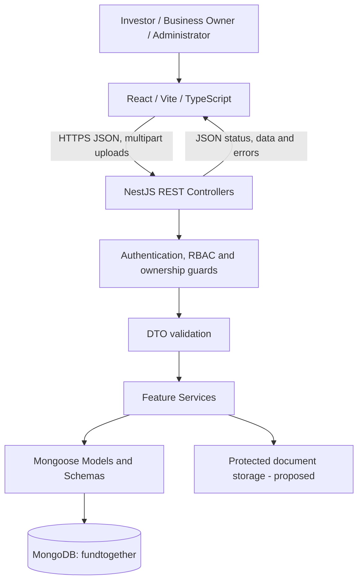
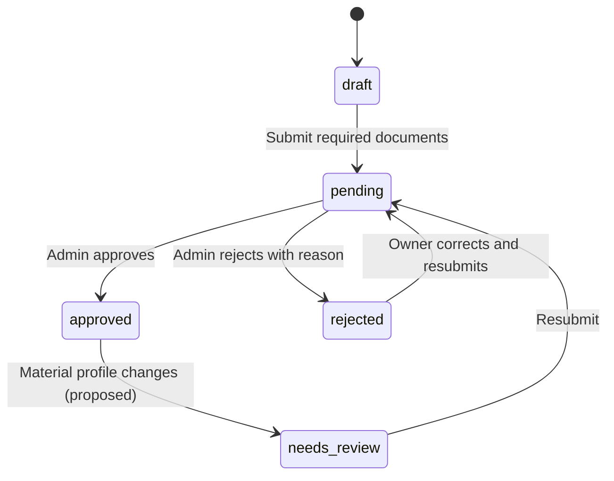
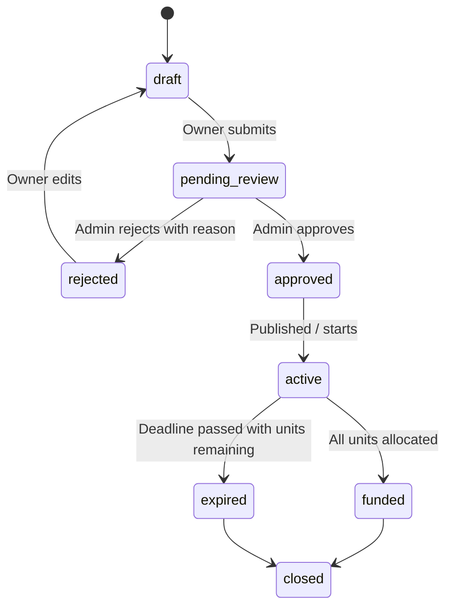
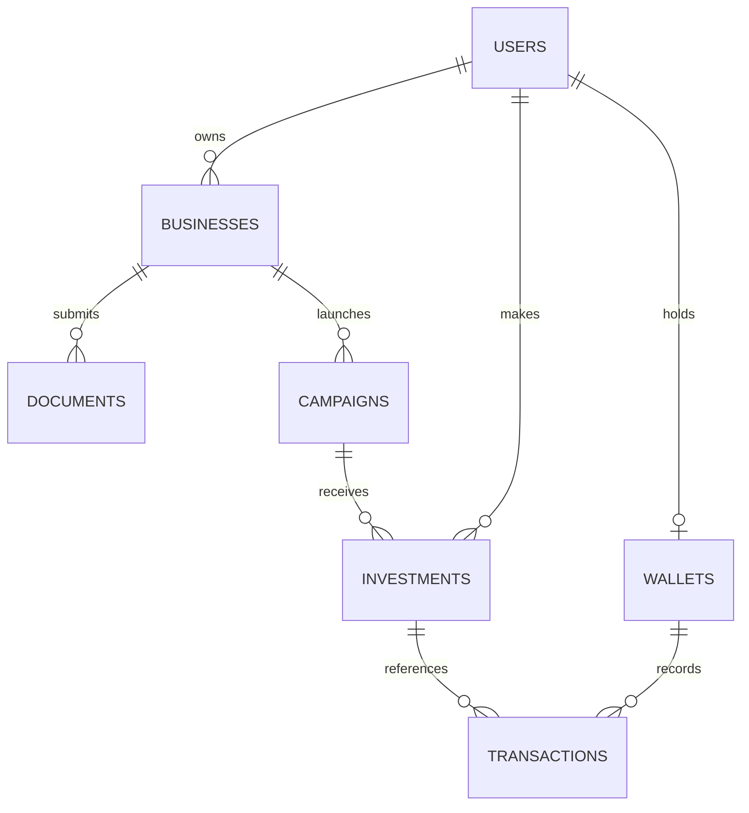
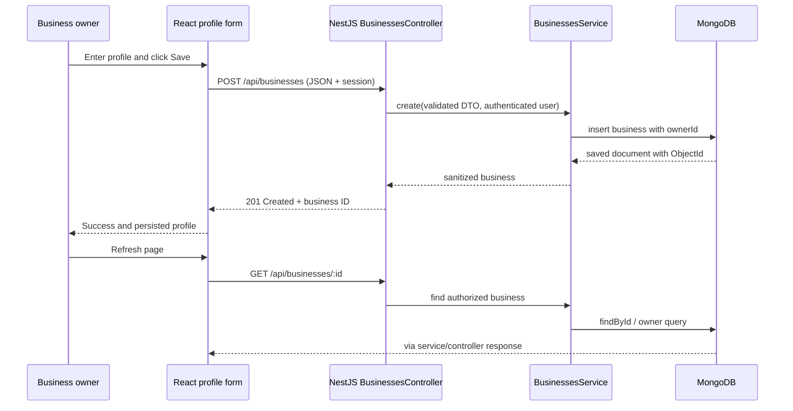
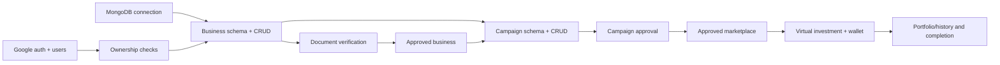

# FundTogether — Complete Project Specification and Development Blueprint

**Project:** FundTogether  
**Course:** CSE470  
**Team:** Four members  
**System type:** Educational, simulated fractional business-investment platform  
**Status:** Living design specification; not a declaration that all features are implemented  
**Document version:** 1.0 — 16 November 2026

> **Safety and scope boundary:** Every balance, purchase, funding target, transaction and performance statistic on FundTogether is **simulated**. There is no real-money transfer, banking connection, payment gateway, legal investment issuance, settlement, guaranteed return or entitlement to business profits. UI text, API responses and demonstrations must not suggest otherwise.

## 1. Executive summary

FundTogether demonstrates how business owners can request approval to present funding opportunities and how investors can participate by purchasing *virtual fractional units*. An administrator reviews business documentation and campaign submissions before either becomes available to the public. The system records user accounts, business profiles, campaigns and, in its full version, virtual wallets and investment transactions. It illustrates ownership, approval workflows, data validation, role-based access, API integration and persistent database operations; it does **not** operate as a real financial service.

**Problem being addressed:** Small businesses may be difficult for prospective backers to discover and understand; large all-or-nothing contributions are inaccessible in many hypothetical funding scenarios. FundTogether provides an educational model for exploring smaller investment units, reviewing businesses, managing approval stages and visualizing collective simulated funding. It does not claim to solve actual financing, securities, regulatory or liquidity problems.

**Basic relationship:** One user with a business-owner role can manage their authorized business profile(s); each business may create campaigns after approval; many investor users may record virtual purchases against approved campaigns. Administrators inspect and decide business and campaign submissions. Exact limits on businesses per owner and multiple roles per account remain open decisions.

### 1.1 Requirement and status legend

- **Confirmed requirement (CR):** Explicitly defined project behavior or restriction.
- **Agreed design (AD):** Stack, design pattern or workflow selected for development; may be revised with justification.
- **Proposed feature/design (P):** Suggested implementation of a requirement, not confirmed final scope.
- **Open decision (OD):** Needs team or faculty confirmation before relying on it as a requirement.
- **Observed development status:** Based on prior setup discussion; verify current code and repository before claiming an implementation is complete.

### 1.2 Project scope classification

| Item | Classification | Notes |
|---|---|---|
| Educational simulated investment platform; three roles | CR | Investor, business owner, administrator |
| No real money, banking or payment processing | CR | Enforce in content and architecture |
| Business profile/classification and campaign creation with MongoDB persistence | CR | First milestone's two functional features |
| Business-owner approval gate before campaign creation | CR | Backend must enforce |
| Google Sign-In and shared login for all three roles | CR | Requested supporting functionality; do not confer admin access during sign-up |
| React + TypeScript + Vite + Tailwind; NestJS + TypeScript + MongoDB/Mongoose | AD | Frontend and backend separate; REST JSON |
| Four-person collaboration through GitHub | CR/AD | Branch strategy proposed below |
| MVC mapping: React view, NestJS controller, Mongoose model, NestJS service for logic | AD; faculty approval pending | Not identical to classic server-rendered MVC |
| Documents, admin feedback, campaign review, investor wallet and investment records | CR at conceptual workflow level | Complete implementation phasing remains to be agreed |
| Search, filters, portfolio analytics, notifications, audit dashboard | P | Useful enhancements, not milestone prerequisites |
| Virtual-balance starting amount, failure/refund semantics, partial funding, unit ownership rights | OD | Must not invent real financial consequences |
| Multi-business ownership, investor/business-owner dual role, admin provisioning | OD | Initial proposed rules below |

### 1.3 Current baseline versus target

The team has described a working Figma-derived **React frontend prototype** featuring landing, marketplace, campaign details, business registration, business profile, document submission and document status screens. The prototype contains illustrative/hardcoded content, not necessarily real network/database integration. The team also reported scaffolding a **NestJS** backend, connecting **local MongoDB** through `@nestjs/mongoose`, and generating the `businesses` CRUD resource; successful startup and `MongooseCoreModule` initialization were observed in the terminal. These observations **do not** prove that CRUD, authentication, uploads or approvals are implemented. Git commit/push status remains **unverified** after identity configuration trouble. Re-check the repository before interpreting the project as delivered.

**Near-term priority:** Complete and demonstrate persisted Business Profile/Classifications operations and persisted Campaign Creation operations before expanding the larger simulation lifecycle. A previously discussed first milestone date was **19 November 2026**; confirm the course submission deadline before scheduling work.

---

## 2. Stakeholders, roles and permissions

### 2.1 Investor

**Primary goal:** Browse vetted demonstrations and participate in virtual fractional campaigns.

**Expected journey:** Sign in with Google; choose investor onboarding (if role selection is implemented); open marketplace; search or filter *approved* published campaigns; inspect business profile, campaign target, unit price, duration and progress; enter desired unit quantity; review `quantity × unitPrice` and remaining virtual balance; confirm a simulated investment; see investment record, updated wallet balance, remaining campaign units and portfolio/history.

**Confirmed conceptual capabilities:** Marketplace exploration, approved campaign visibility and simulated investments using virtual balances. **Proposed supporting capabilities:** Personalized watchlists, filters, investment calculator, wallet page, holdings/portfolio view, transaction history and notification preferences. These become acceptance requirements only if the team selects them for delivery.

**Restrictions:** Cannot approve businesses/campaigns, alter other users' data, set their own balance arbitrarily, buy beyond available units or spend more than their virtual balance. A virtual unit is an educational accounting entry, not an actual share or enforceable claim.

### 2.2 Business owner

**Primary goal:** Register and verify a business, then launch and monitor simulated funding campaigns.

**Lifecycle:** Google sign-in/account creation → business-owner onboarding → business profile/classification → submit supporting documents → pending review → administrator approval or rejection with reason → edit and resubmit as needed → *only when approved*, create campaign draft → validate and submit campaign → admin decision → approved publication → monitor progress and campaign outcomes. Profile editing follows ownership restrictions; changes to verified details may trigger a re-review (P/OD).

**Must not:** Change `verificationStatus` using ordinary profile CRUD; upload unapproved file types; create campaigns while pending/rejected; edit or delete another business's records; make a pending campaign appear publicly via client-side changes.

### 2.3 Administrator

**Primary goal:** Review submissions, enforce platform rules and oversee simulated activity.

**Lifecycle:** Sign in using the shared authentication entry; backend resolves a previously provisioned `admin` role; open protected dashboard; list business applications and securely view authorized documents; approve or reject with a reason; examine resubmissions; review submitted campaigns; approve or reject them; inspect aggregate platform activity and audit history. Administrative actions must be logged (P, strongly recommended).

**Restrictions:** Google account existence is not evidence of administrator authorization. A new user must never choose `admin` in a public form or obtain it via a modified request body. Role provisioning must use a trusted seed/admin process.

### 2.4 Proposed permission matrix

| Action | Investor | Business owner | Administrator |
|---|---|---|---|
| Shared Google sign-in, view public marketplace | Yes | Yes | Yes |
| Create/read/edit own business | No | Yes | Oversight only, unless specified |
| Upload/correct own business documents | No | Yes | Review/download according to policy |
| Approve/reject business | No | No | Yes |
| Create/edit own campaign draft | No | Yes, if business approved | Oversight/review |
| Approve/reject campaign | No | No | Yes |
| Buy virtual campaign units | Yes | OD | No by default |
| View own wallet/portfolio | Yes | OD | No by default |
| Grant admin role | No | No | Trusted provisioning only |

All checks must occur **server-side**; hiding controls in React improves usability but is not authorization.

---

## 3. Technology, architecture and responsibilities

| Technology | Responsibility |
|---|---|
| React | Browser UI: pages, forms, navigation, status, dashboards and interaction |
| TypeScript | Types for React components, API contracts, NestJS services and DTOs |
| Vite | Frontend development server and production bundling |
| Tailwind CSS v4 | Utility classes and shared theme styling |
| NestJS | Backend HTTP API, routing, validation, authorization, orchestration and domain logic |
| MongoDB Community (local development) | Persistent document data in collections |
| Mongoose / `@nestjs/mongoose` | Schema/model definition, document validation and queries from NestJS |
| Postman | Manually test endpoints, positive and negative scenarios |
| Git + GitHub | Version control, feature branches, code review and collaboration |
| Google Identity / OAuth or OpenID Connect | Verify Google account identity through a secure chosen flow; issue application session/JWT |

### 3.1 Request and storage architecture



Development defaults: `http://localhost:5173` (React), `http://localhost:3000` (NestJS), `mongodb://127.0.0.1:27017/fundtogether` (MongoDB). These addresses are environment defaults, **not** production configurations. MongoDB Compass is a GUI to inspect records, **not** a dependency between NestJS and MongoDB.

**Data request example:** User submits a profile. React gathers values and sends `POST /businesses`. NestJS authenticates the caller (once auth is integrated), validates DTO, checks owner permissions, invokes `BusinessesService.create`, which calls the injected Mongoose `BusinessModel.create`. Mongoose applies schema rules and writes MongoDB data. NestJS returns `201 Created` and a sanitized profile. React updates the UI. Refreshing should retrieve the same record via `GET`, proving persistence.

### 3.2 MVC clarification and NestJS structure

| Architectural concept | FundTogether implementation |
|---|---|
| **Model** | Mongoose business, campaign, user, etc. schema/model |
| **View** | Separate React application |
| **Controller** | NestJS REST controller routes |
| **Business logic layer** | NestJS services; not a classical MVC letter |
| **Module** | NestJS wiring/dependency injection; not a classical MVC letter |
| **DTO** | Input shape and validation at API boundary; not MVC itself |

**Faculty confirmation pending:** This is a client–server application organized using MVC principles, **not classic server-rendered MVC**. If CSE470 requires strict MVC framework or folder conventions, seek written approval before presenting this mapping as compliant. Do not duplicate `models/`, `schemas/` and `entities/` only to satisfy naming aesthetics; with Mongoose, use the schema/model as the persistence model.

### 3.3 Recommended repository layout

```text
FundTogether/
├── .gitignore
├── README.md
├── FUNDTOGETHER_PROJECT_SPECIFICATION.md
├── client/
│   ├── src/
│   │   ├── App.tsx                       # current landing prototype
│   │   ├── main.tsx                      # current bootstrap/router
│   │   ├── BusinessRegistration.tsx
│   │   ├── BusinessProfileSetup.tsx
│   │   ├── BusinessDocumentSubmission.tsx
│   │   ├── DocumentReviewStatus.tsx
│   │   ├── Marketplace.tsx
│   │   ├── CampaignDetails.tsx
│   │   ├── components/                   # introduce as reuse demands
│   │   ├── api/                          # proposed typed HTTP client
│   │   └── index.css
│   ├── package.json
│   └── vite.config.ts
└── server/
    ├── src/
    │   ├── main.ts                       # bootstrap, CORS, pipes
    │   ├── app.module.ts                 # root feature/Mongoose wiring
    │   ├── auth/                         # login verification, tokens, guards
    │   ├── users/                        # accounts, roles
    │   ├── businesses/
    │   │   ├── businesses.module.ts
    │   │   ├── businesses.controller.ts
    │   │   ├── businesses.service.ts
    │   │   ├── dto/
    │   │   │   ├── create-business.dto.ts
    │   │   │   └── update-business.dto.ts
    │   │   └── schemas/business.schema.ts
    │   ├── campaigns/                    # equivalent module/service/controller/dto/schema
    │   ├── documents/                    # optional separate module when complexity grows
    │   ├── admin/                        # optional shared review endpoints
    │   ├── wallets/                      # later
    │   ├── investments/                  # later
    │   └── common/                       # shared guards, filters, decorators as needed
    ├── test/
    ├── .env.example
    └── package.json
```

**Current-versus-planned note:** A folder's presence is not proof its feature works. NestJS-generated `*.spec.ts` files are tests. Generated `entities/business.entity.ts` can be omitted from a Mongoose-based implementation if unreferenced. Avoid generating empty folders/modules prematurely. The Figma prototype currently uses a custom route selector in `main.tsx`; a routing library is a *proposed future refactor*, not a prerequisite for CRUD.

---

## 4. Complete chronological workflows

### 4.1 Workflow A — Account registration and login

1. **UI:** A shared login page offers **Continue with Google**; optionally explains simulated nature and terms.
2. **Google:** User authenticates through an approved OAuth 2.0/OpenID Connect flow. Use an authorized origin/redirect URI and a Google Cloud OAuth client configuration; never trust a raw email supplied by React as proof of login.
3. **API:** Backend verifies the Google credential (issuer, audience/client ID, expiration, signature and relevant claims) or completes an authorization-code flow; flow choice is an **OD**.
4. **Database:** `users` collection finds/creates the user using a stable provider subject such as `googleSub`. Store display name, email, role(s), timestamps. Do not store Google account passwords.
5. **Onboarding:** New non-admin users choose allowed role: investor or business owner; backend validates the selection. Google identity and platform role are separate concerns.
6. **Session:** Backend issues an authenticated application session or short-lived access JWT plus controlled refresh mechanism (AD to confirm). Store tokens securely. Avoid logging secrets.
7. **Routing:** React displays the authorized dashboard. All protected REST routes validate the backend session/role on every request.
8. **Failures:** Expired/replayed credential → `401`; unsupported role → `403`; bad login payload → `400`; account disabled → deny access; provider downtime → friendly retry state.

**Google-only versus password login:** Google Sign-In is explicitly required. Local email/password accounts and password hashing are **optional** unless selected. If local passwords are added, hash with a modern adaptive algorithm such as Argon2id or bcrypt, never store plaintext; no password hashing is needed for a Google-only login because passwords never reach FundTogether.

### 4.2 Workflow B — Business registration, profile and classification

1. **UI:** Authenticated business owner opens registration/profile setup; collect official name, category, size, founding year, division, district, address, description, employee count, website (optional), email, phone.
2. **Client:** Show inline required-field messages and preserve form state. Client-side validation improves feedback but cannot replace backend validation.
3. **HTTP:** `POST /businesses` with JSON; include authenticated session, not a spoofable client-supplied owner ID.
4. **NestJS:** Controller receives request; DTO validates types/lengths/enums; service assigns `ownerId` from verified user identity and `verificationStatus='draft'` or `'pending'` according to submission-stage policy (OD).
5. **Mongoose:** Persist to `fundtogether.businesses`; save created/updated timestamps. Generate real MongoDB `_id`.
6. **Response:** Return `201` and business `id`; show saved confirmation. Use `GET /businesses/me` or `GET /businesses/:id` to repopulate from DB after reload.
7. **Update:** `PATCH /businesses/:id` only if owner matches; avoid allowing updates to protected fields such as `ownerId`, `verificationStatus`, or approvals.
8. **Delete:** `DELETE` restricted and documented; hard deletion might conflict with campaigns/document audit history. Soft-delete/archiving is **recommended** after downstream records exist (OD).

**Business profile fields:**

| Field | Type | Basic constraint | Requirement status |
|---|---|---|---|
| `officialName` | string | Required, nonblank, bounded length | CR |
| `category` | enum/string | Grocery/retail; restaurant/food; bakery; clothing/fashion; agriculture; manufacturing; renewable energy; transportation/delivery; other | CR |
| `size` | enum | `micro`, `small`, `medium`, `large` | CR |
| `establishedYear` | integer | Sensible historic year, not in future | CR with proposed validation |
| `division`, `district` | string | Required and consistent when geographic selector is available | CR |
| `address` | string | Detailed address, bounded length | CR |
| `description` | string | Required; reasonable minimum/maximum | CR |
| `employeeCount` | integer | Nonnegative | CR with proposed validation |
| `website` | URL/string | Optional; valid HTTP(S) URL | CR field, optionality proposed |
| `businessEmail` | email | Valid email format | CR |
| `contactPhone` | string | Bangladesh format or agreed international format | CR |
| `ownerId` | ObjectId | From authenticated user, not arbitrary client input | AD/security |
| `verificationStatus` | enum | Server-managed status | CR |

### 4.3 Workflow C — Document submission and admin verification

**Required document categories:** trade license, business owner's national ID, proof of business address; **optional:** TIN certificate and additional supporting documents. Exact mandatory rule per business type, maximum count and retention duration require confirmation.

1. **UI:** Owner sees required/optional upload slots, file selection, size/type feedback and current status.
2. **Upload:** Send `multipart/form-data` to an authenticated endpoint associated with an owned business; only file metadata belongs in JSON after storage.
3. **Backend validation:** Check MIME *and* file signature where possible; extension alone is insufficient. Limit file size/count; sanitize filenames; prevent traversal; reject executables and suspicious formats. Example allowed formats: PDF/JPEG/PNG (**P**, not final).
4. **Storage:** For a local university demo, protected disk folder outside the public web root is a practical proposal. MongoDB stores metadata, ownership, type, status and a protected storage key/path. Alternative: GridFS/object storage (**OD**). Do not place sensitive NIDs under React `public/` or in Git.
5. **Submission:** Owner submits application after required documents exist. Backend changes status to `pending` and records review submission time.
6. **Admin queue:** Authorized administrator reads a restricted list and accesses documents through permission-checked download routes.
7. **Decision:** `approved` or `rejected` with saved reason/admin ID/time; audit log strongly recommended. Rejection reason shown to owner; never silently discard previous revision.
8. **Resubmission:** Owner corrects selected files and resubmits; status returns to `pending`, with revision history retained as needed.
9. **Gate:** Service processing campaign creation **must query business verification status and require `approved`**. A disabled frontend button alone is insufficient.



**Privacy caution:** National ID is sensitive personal data. Minimize collection to course requirements, restrict administrator access, encrypt data at rest when feasible, set deletion/retention policy and never use real personal documents in a publicly shared demo without explicit informed consent. Synthetic documents are safer for demonstrations.

### 4.4 Workflow D — Campaign creation, review and publication

1. **Precondition:** Logged-in owner has an `approved` business they own; backend verifies, even if campaign UI says allowed.
2. **UI:** Owner fills title, description, target amount, unit price, duration, funding purpose, use of funds, and supporting information.
3. **Validation:** Positive funding target/unit price; whole positive number of units; valid date interval; required descriptive fields; plausible range; `target % unitPrice === 0` if partial units are disallowed.
4. **Calculation:** `totalUnits = fundingTarget / unitPrice`; units are virtual. The client may preview calculation, but backend recomputes.
5. **Persistence:** `POST /campaigns` creates `draft` campaign linked by `businessId` and owner identity; no approval-by-owner allowed.
6. **Submission:** Owner submits for review; service checks completeness, allowed transitions and current business approval.
7. **Admin:** Reviews campaign, may reject with reason or approve; backend saves reviewer/time and status.
8. **Publication:** Only approved campaigns enter publicly searchable marketplace; rejected/draft campaigns remain private to owner/admin.
9. **Monitoring:** Owner sees approved funding progress, purchased/available units, lifecycle state and aggregate *simulated* transactions.

**Worked example (Bangladeshi taka notation is illustrative only):**

| Property | Value |
|---|---:|
| Business | Shobuj Bazar |
| Funding target | ৳50,00,000 (virtual) |
| Unit price | ৳500 (virtual) |
| Total units | 10,000 |

\[
\text{Total Units} = \frac{\text{Funding Target}}{\text{Price per Unit}} = \frac{5{,}000{,}000}{500}=10{,}000
\]

A campaign's monetary display is a **virtual reference amount**, not payment due or proceeds owed.



Exact start date, expiration handling, cancellation, edit lock after purchase and resubmission rules are **OD**. Campaign authorization must be rechecked on transitions, not just initial creation.

### 4.5 Workflow E — Investor discovery and simulated investment

1. Investor signs in; dashboard shows virtual wallet balance (initial allocation is an **OD**).
2. Marketplace queries **approved, published, eligible** campaigns. Filters might include category, target size and remaining duration (**P**).
3. Campaign detail displays business, purpose, total/remaining units, unit price, funding progress, and simulation disclaimer.
4. Investor enters number of units `q` (strict positive integer). React previews `cost = q × unitPrice` and resulting balance.
5. NestJS re-fetches campaign and wallet data; validates investor role, campaign status, non-expiration, `q ≤ remainingUnits`, `cost ≤ virtualBalance`, and duplicate request protection.
6. A **single consistent operation** records investment, decreases wallet balance, increments units purchased, and adds transaction/audit entries. Use MongoDB transactions with a replica set where feasible or a carefully designed atomic/conditional update strategy; **standalone local MongoDB does not support multi-document transactions**.
7. API returns investment receipt and balances; React refreshes wallet, progress and portfolio. Duplicate retries must not purchase twice (e.g., idempotency key).

**Numerical example:** Investor has ৳20,000 virtual balance; campaign unit price is ৳500; buys 12 units. Virtual debit = `12 × 500 = ৳6,000`; new wallet = `৳14,000`. If a campaign starts with 10,000 units and has already sold 4,000, then after this purchase it has 4,012 purchased and 5,988 remaining. Funding progress = `(4,012/10,000) × 100 = 40.12%`, equivalent to `৳20,06,000 / ৳50,00,000` of simulated allocation. Reject a request for 6,001 units if only 5,988 remain; reject a purchase over the wallet's remaining balance.

**Portfolio/history proposal:** Store investment references, original unit quantity, simulated total cost, timestamp and status. Show units held by campaign and chronological virtual transactions. Do not imply market value, dividends or real redemption rights without separately defined simulation rules.

### 4.6 Workflow F — Campaign completion

- **Successfully funded:** `remainingUnits = 0` before deadline. Mark `funded`, prevent further purchases, maintain immutable investment history; optionally transition to `closed` after administrative/process closure.
- **Insufficient funding at deadline:** Mark `expired`/`closed`; stop purchases and show amount allocated and remaining units. **What happens to virtual wallet debits or invested units is an open decision**; avoid inventing refunds, returns, transfer rights, penalties or legal consequences.
- **Cancellation or rejection after publication:** Not specified. If supported, add explicit transition policy and reconciliation rules before implementation.
- **Records:** Preserve investment and transaction history for audit and teaching; privacy/data-retention decisions still apply.

---

## 5. Detailed feature catalogue

The following feature cards describe intended behavior; **they do not assert implementation**. `API` paths are proposed in §8.

### 5.1 Core milestone feature F1 — Business Profile & Classification CRUD

| Attribute | Specification |
|---|---|
| Purpose | Persist business identity and classification, independently from UI refresh |
| Roles | Business owner; administrator can inspect |
| Preconditions | Authenticated business-owner account in secured final flow; own profile exists for read/update/delete |
| Input | Official name, category, size, founding year, location/address, description, employees, website/email/phone |
| Main process | Validate DTO → check owner → create/find/update/archive document → return sanitized result |
| Backend | `BusinessesController` → `BusinessesService` → Mongoose `Business` |
| DB operations | `insertOne`, `find`, `findById`, conditional `findOneAndUpdate`, optional soft-delete |
| Output | Persisted `_id`, fields, timestamps; correct success codes |
| Validation | Required fields, enum limits, data formats, length, numeric ranges |
| Authorization | Only owner changes their business; role/status not client-editable |
| Errors | 400 invalid input, 401 unauthenticated, 403 unauthorized, 404 nonexistent, 409 duplicate/conflict |
| Acceptance | POST saves; GET after restart returns same data; PATCH persists; DELETE/archival policy works; wrong-owner access denied |

**Milestone implementation note:** If authentication is not yet ready, development can test CRUD locally with a clearly labeled temporary owner fixture, but this is **not** a secure completed user-facing feature. Do not claim full authorization until verified.

### 5.2 Core milestone feature F2 — Campaign Creation CRUD

| Attribute | Specification |
|---|---|
| Purpose | Create and maintain campaigns linked to businesses |
| Roles | Approved business owner; administrator can review |
| Preconditions | Owned business exists and is approved (full final requirement); authorized session |
| Input | Business ID, title, description, target, unit price, duration, funding purpose, use of funds, supporting info |
| Main process | Check business/ownership/approval → validate and compute units → persist draft → retrieve/edit/delete per status policy |
| Backend | `CampaignsController` → `CampaignsService` → Mongoose models |
| DB operations | Insert, find, update, restricted delete/archive; indexed business references |
| Output | Campaign ID, computed `totalUnits`, initial `remainingUnits`, state, timestamps |
| Validation | Target/price positive; integer unit count; sensible dates; status transitions |
| Authorization | Only owner edits drafts; admin approves; investors cannot create |
| Errors | 400 invalid target, 403 unapproved/non-owner, 404 business/campaign missing, 409 forbidden state |
| Acceptance | POST persists, GET returns, PATCH persists, ownership/business association verified, unapproved-business creation rejected |

### 5.3 Supporting feature F3 — Shared authentication & role onboarding

| Attribute | Specification |
|---|---|
| Purpose | Single Google login for investor, business owner and admin |
| Roles | All |
| Preconditions | Google OAuth client configured; trusted admin provisioning |
| Input | Verified Google credential/authorization code; onboarding choice for non-admin |
| Main process | Verify Google → find/create user → safely establish role → issue app session |
| Backend/DB | `AuthService`, `UsersService`, `users` records, token/session validation |
| Output | Minimal user profile, authenticated session, role-aware navigation |
| Validation/access | Google token audience/issuer/signature; no client-elevated admin role |
| Errors | 401 invalid credential, 403 disabled/forbidden, 409 account conflict |
| Acceptance | Google login works; owner/investor roles assigned per policy; admin cannot self-register; protected routes reject forged role |

### 5.4 Supporting feature F4 — Business document submission

| Attribute | Specification |
|---|---|
| Purpose | Receive and manage verification evidence |
| Roles | Owner submits, admin reviews |
| Preconditions | Owned business exists; accepted formats and sizes agreed |
| Input | Document type, PDF/image file, optional notes |
| Main process | Auth → validate file/signature/limits → protected storage → metadata record |
| DB | `documents` records referencing business/owner and protected storage key |
| Output | Document ID, type, uploaded date, review status |
| Validation/access | Allowed MIME/signature/count/size; restrict reads to owner/admin; no public NID URLs |
| Errors | 400 unsupported file, 413 oversized, 403 non-owner, 404 business |
| Acceptance | File survives restart; metadata persists; cannot access another user's document |

### 5.5 Supporting feature F5 — Business verification

| Attribute | Specification |
|---|---|
| Purpose | Admin adjudicates submitted business documents |
| Roles | Owner views; admin decides |
| Preconditions | Required documents submitted; admin authenticated |
| Input | Decision and mandatory rejection reason when rejecting |
| Process/DB | Status transitions in businesses/documents; review metadata/audit event |
| Output | Approved/rejected/pending status and owner-visible feedback |
| Validation/access | Only admin decision; pending required before decision; prevent own-role escalation |
| Errors | 400 incomplete submission, 403 non-admin, 409 already decided |
| Acceptance | Approval unlocks campaign creation server-side; rejection blocks it; resubmission returns to review queue |

### 5.6 Supporting feature F6 — Campaign review and marketplace

| Attribute | Specification |
|---|---|
| Purpose | Ensure only approved campaigns are published |
| Roles | Business owner submits; admin decides; all permitted users browse |
| Preconditions | Approved business and valid campaign draft |
| Input | Campaign fields, submit action, admin decision/reason |
| Process/DB | Campaign status machine; query only published/approved for marketplace |
| Output | Review status, public campaign list/detail |
| Validation/access | Server checks ownership and status; only admin can approve |
| Errors | 403 wrong role, 409 invalid transition, 404 nonexistent |
| Acceptance | Pending/rejected campaign inaccessible in public listing; approved appears; admin decision logged |

### 5.7 Supporting feature F7 — Virtual wallet and investment

| Attribute | Specification |
|---|---|
| Purpose | Simulate fractional unit purchases without actual payment |
| Roles | Investor |
| Preconditions | Wallet allocated, approved active campaign with remaining units |
| Input | Campaign ID, unit quantity, idempotency key |
| Process/DB | Validate → ensure consistent wallet/campaign updates → investment + transaction entries |
| Output | Virtual receipt, remaining balance, remaining units, progress |
| Validation/access | Unit quantity positive integer; balance/stock sufficient; duplicate prevention; investor only |
| Errors | 400 invalid quantity, 403 forbidden, 409 insufficient units/balance or duplicate conflict |
| Acceptance | Exact arithmetic; no negative balances/units; refresh preserves records; simultaneous requests cannot oversell |

### 5.8 Proposed future features

| Feature | Benefit | Dependency |
|---|---|---|
| Investment portfolio dashboard | Show per-campaign virtual holdings | Investment records |
| Transaction history and export | Teach simulated account ledger | Wallet and transactions |
| Search, category filters, sorting | Easier discovery | Published campaign query |
| Notifications | Inform on review decisions and campaign progress | Events/templates |
| Admin analytics/audit viewer | Operational transparency | Audit events and permissions |
| Campaign bookmarks | Return to interesting opportunities | User/campaign association |
| Analytics charts | Visualize virtual funding and campaign outcomes | Accurate persistent aggregates |

---

## 6. Data model and MongoDB design

All collections reside under database `fundtogether`. MongoDB uses `_id: ObjectId` unless a specific alternative is justified; represent ObjectIds as strings in JSON API responses. Use schema validation with DTO validation and indexes; neither alone replaces authorization.

### 6.1 Collection definitions

| Collection | Important fields and types | Links/indexes | Rules |
|---|---|---|---|
| `users` | `_id`, `googleSub:string`, `email:string`, `displayName:string`, `roles:string[]` or single `role`, `isActive:boolean`, timestamps | Unique `googleSub`; email lookup index (unique only with agreed identity policy) | Admin role assigned via trusted method, not client request |
| `businesses` | `_id`, `ownerId:ObjectId`, profile fields from §4.2, `verificationStatus:enum`, `rejectionReason?:string`, timestamps, optional `deletedAt` | Index `ownerId`, `verificationStatus`; possible unique business identifier if agreed | Required profile validation, protected admin fields |
| `documents` | `_id`, `businessId:ObjectId`, `ownerId:ObjectId`, `type:enum`, `storageKey:string`, `originalName:string`, `mimeType:string`, `sizeBytes:number`, `status:enum`, `uploadedAt`, optional review metadata | Index `(businessId,type,uploadedAt)` | Metadata only; do not expose sensitive filesystem paths or public URLs |
| `campaigns` | `_id`, `businessId:ObjectId`, `ownerId:ObjectId`, `title`, `description`, `fundingTarget:number`, `unitPrice:number`, `totalUnits:number`, `remainingUnits:number`, `durationDays:number` or dates, `purpose`, `useOfFunds`, `status`, timestamps | Index `(status,createdAt)`, `businessId`, `ownerId` | Computed unit fields server-managed; approval gate; nonnegative stock |
| `wallets` | `_id`, `userId:ObjectId`, `balanceUnits:number` or `balanceMinorUnits:integer`, timestamps | Unique `userId` | Only backend can credit/debit; no arbitrary balance update endpoint |
| `investments` | `_id`, `investorId:ObjectId`, `campaignId:ObjectId`, `units:number`, `unitPriceAtPurchase:number`, `totalCost:number`, `status`, `createdAt`, `idempotencyKey:string` | Index investor/date, campaign/date; unique `(investorId,idempotencyKey)` | Immutable purchase facts; no overselling |
| `transactions` | `_id`, `walletId:ObjectId`, `userId:ObjectId`, `investmentId?:ObjectId`, `type:enum`, `amount:number`, `balanceAfter:number`, `createdAt` | Index wallet/date and investment ID | Ledger entries append-only by policy |
| `notifications` (optional) | `_id`, `recipientId:ObjectId`, `type`, `message`, `readAt?`, `createdAt` | Index recipient/date | No sensitive documents in notification contents |

**Currency arithmetic:** Because all amounts are simulated, define an integer smallest unit (e.g. virtual paisa) or explicitly restrict virtual amounts to whole taka; avoid floating-point rounding. Example below uses whole virtual taka only for readability. A campaign's `totalUnits`, `remainingUnits` and `fundingTarget` must remain mathematically consistent.

**Relationships:** `users._id` → `businesses.ownerId`; `businesses._id` → `documents.businessId` and `campaigns.businessId`; `users._id` → `wallets.userId` and `investments.investorId`; `campaigns._id` → `investments.campaignId`; `investments._id` → relevant `transactions.investmentId`.



### 6.2 Example documents (illustrative, not actual database snapshots)

**User**

```json
{
  "_id": "66a100000000000000000001",
  "googleSub": "google-subject-example-not-a-real-user",
  "email": "owner@example.test",
  "displayName": "Example Business Owner",
  "role": "business_owner",
  "isActive": true
}
```

**Business**

```json
{
  "_id": "66a200000000000000000001",
  "ownerId": "66a100000000000000000001",
  "officialName": "Shobuj Bazar",
  "category": "grocery_retail",
  "size": "small",
  "establishedYear": 2020,
  "division": "Dhaka",
  "district": "Dhaka",
  "address": "Example address, Dhaka",
  "description": "An illustrative neighborhood grocery store.",
  "employeeCount": 8,
  "website": null,
  "businessEmail": "contact@example.test",
  "contactPhone": "+8801000000000",
  "verificationStatus": "pending",
  "createdAt": "2026-11-16T00:00:00.000Z",
  "updatedAt": "2026-11-16T00:00:00.000Z"
}
```

**Document metadata**

```json
{
  "_id": "66a300000000000000000001",
  "businessId": "66a200000000000000000001",
  "ownerId": "66a100000000000000000001",
  "type": "trade_license",
  "storageKey": "protected/businesses/66a2/trade-license-example.pdf",
  "originalName": "trade-license-example.pdf",
  "mimeType": "application/pdf",
  "sizeBytes": 145000,
  "status": "submitted",
  "uploadedAt": "2026-11-16T00:00:00.000Z"
}
```

**Campaign**

```json
{
  "_id": "66a400000000000000000001",
  "businessId": "66a200000000000000000001",
  "ownerId": "66a100000000000000000001",
  "title": "Shobuj Bazar Expansion",
  "description": "Illustrative campaign for shop expansion.",
  "fundingTarget": 5000000,
  "unitPrice": 500,
  "totalUnits": 10000,
  "remainingUnits": 10000,
  "durationDays": 90,
  "purpose": "Store expansion",
  "useOfFunds": "Illustrative equipment and inventory budget",
  "status": "draft",
  "createdAt": "2026-11-16T00:00:00.000Z"
}
```

**Wallet, investment and virtual transaction**

```json
{
  "wallet": { "userId": "66a500000000000000000001", "balanceVirtualTaka": 14000 },
  "investment": {
    "investorId": "66a500000000000000000001",
    "campaignId": "66a400000000000000000001",
    "units": 12,
    "unitPriceAtPurchase": 500,
    "totalCostVirtualTaka": 6000,
    "status": "recorded",
    "idempotencyKey": "example-purchase-001"
  },
  "transaction": {
    "type": "virtual_investment_debit",
    "amountVirtualTaka": -6000,
    "balanceAfterVirtualTaka": 14000
  }
}
```

The wallet/investment sample omits IDs and timestamps for brevity; actual stored documents require these. **Never** insert the illustrative example identifiers blindly into production data. Indexes, enum values and timestamp policies should be aligned across DTOs, schemas and API documentation before implementation.

---

## 7. NestJS modules, validation and security architecture

### 7.1 Modules and dependency injection

Each feature has a module that registers its controllers, services and Mongoose model. Example pattern (illustrative):

```ts
@Module({
  imports: [MongooseModule.forFeature([{ name: Business.name, schema: BusinessSchema }])],
  controllers: [BusinessesController],
  providers: [BusinessesService],
  exports: [BusinessesService]
})
export class BusinessesModule {}
```

`AppModule` imports `MongooseModule.forRoot(process.env.MONGODB_URI)` via configuration and feature modules. A **controller** parses HTTP input and delegates; a **service** enforces business policy and calls models; a **provider** is an injectable class/service; a **DTO** controls input shape; a **Mongoose schema** defines persistence constraints. `main.ts` bootstraps NestJS and configures CORS for the frontend origin, global validation and error behavior. Do not put credentials directly in committed source files.

**DTO validation example:** `CreateBusinessDto` may use `class-validator` decorators such as `@IsString`, `@IsNotEmpty`, `@IsEnum`, `@IsInt`, `@IsEmail`, `@IsOptional`; `ValidationPipe({ whitelist:true, forbidNonWhitelisted:true, transform:true })` applies them. Validation packages/configuration must actually be installed/registered before claiming they work. For PATCH, derive `UpdateBusinessDto` via `PartialType` while keeping protected fields server-managed. String `:id` values must be checked for MongoDB ObjectId validity, not converted using generated `+id` numeric coercion.

### 7.2 Security and operational rules

- **Authentication:** Validate the real Google identity credential; select either server-verified ID token exchange or authorization-code flow with PKCE as appropriate. Keep Google client secret server-side if a flow requires one. Restrict allowed redirect URLs.
- **Session:** Prefer secure HttpOnly/SameSite cookies for same-site deployments or carefully scoped bearer JWT flows; handle CSRF for cookie-based writes, token expiration, logout and refresh. Final choice **OD**.
- **Authorization:** Role guards + per-record ownership checks in services. Never trust role/owner/admin approval fields sent by a client.
- **Password hashing:** Required only if the project adds local passwords. Use adaptive hashing and never store plaintext.
- **Input validation:** Validate all DTOs, URL params, query parameters, file formats and business state transitions. Sanitize output (avoid sending internal storage paths or secrets).
- **Documents:** Limit count/size; scan/screen where feasible; serve using authenticated endpoints; apply retention/access controls. Use synthetic data for public faculty demos.
- **Configuration:** `.env` and `.env.*` must be Git-ignored; provide `.env.example` with placeholder names only (`MONGODB_URI`, `PORT`, `FRONTEND_ORIGIN`, `GOOGLE_CLIENT_ID`, optional token/session secret). Never commit actual secrets or user identity documents.
- **Abuse protection:** Rate-limit authentication and uploads; avoid exposing account existence; make failures informative but not revealing.
- **Investments:** Apply idempotency and conditional stock/balance checks. Distinguish a successful write from a partial failure; a local standalone MongoDB configuration needs an explicitly selected consistency method because multi-document transactions require replica-set support.
- **Auditability:** Record admin decisions and critical virtual-balance actions with time, actor and target; forbid client editing of audit fields.
- **Error handling:** Return consistent JSON errors with an HTTP status and safe message; do not leak stack traces to clients.

### 7.3 Suggested error envelope

```json
{
  "statusCode": 403,
  "code": "BUSINESS_NOT_APPROVED",
  "message": "Business verification must be approved before campaign creation.",
  "path": "/campaigns"
}
```

This is a **proposed** contract. Standard NestJS errors can be used initially if the team agrees; do not introduce a complex exception system for a first milestone.

---

## 8. Proposed REST API contract

**Status of every endpoint listed below: PROPOSED, not proof of implementation.** Generated NestJS CRUD controller route stubs alone do not provide MongoDB persistence, ownership or authentication. Prefixing with `/api` is recommended but optional; choose once and apply consistently. Tables below assume `/api` base path, JSON response bodies unless noted, and an app-auth session for protected routes.

### 8.1 Authentication and users

| Method/path | Purpose | Role | Body / input | Expected response | Key validation |
|---|---|---|---|---|---|
| `POST /api/auth/google` | Exchange/verify Google login | Public | Google credential/code per chosen flow | `200` session and sanitized user | Verify credential and audience |
| `POST /api/auth/logout` | End session | Logged in | Session/CSRF as applicable | `204` | Revoke/clear session |
| `GET /api/auth/me` | Current account | Logged in | None | `200` identity and role | Valid session |
| `POST /api/users/onboarding` | Set first allowed role | New authenticated user | `{ "role":"investor" }` or `business_owner` | `200` user | No `admin` selection |
| `GET /api/users/me` | Read own user profile | Logged in | None | `200` user | Never reveal sensitive auth fields |
| `PATCH /api/users/me` | Update allowed profile fields | Logged in | Display name/preferences | `200` updated user | Cannot change role or Google subject |

### 8.2 Business profiles

| Method/path | Purpose | Role | Request | Response | Important rule |
|---|---|---|---|---|---|
| `POST /api/businesses` | Create profile | Business owner | Full CreateBusinessDto | `201` saved business with ID | Owner from session; protected status defaults |
| `GET /api/businesses/me` | List own businesses | Business owner | Pagination optional | `200` array | Scope by authenticated owner |
| `GET /api/businesses/:id` | Read profile | Owner/admin; public approved view separate | Path ID | `200` business | Ownership/privacy check |
| `PATCH /api/businesses/:id` | Update allowed fields | Owner | Partial DTO | `200` updated business | Ownership, cannot set approval fields |
| `DELETE /api/businesses/:id` | Delete/archive | Owner under policy/admin | Path ID | `204`/`200` | Block if linked records or soft-delete |
| `GET /api/admin/businesses` | Review applications | Admin | status/filter/page | `200` list | Role guard |

### 8.3 Documents and business verification

| Method/path | Purpose | Role | Request | Response | Important rule |
|---|---|---|---|---|---|
| `POST /api/businesses/:id/documents` | Upload proof | Owner | `multipart/form-data`: `type`, `file` | `201` metadata | File validation, secure storage |
| `GET /api/businesses/:id/documents` | List metadata | Owner/admin | Path ID | `200` list | No public URL or raw NID data |
| `GET /api/documents/:documentId/download` | Protected download | Owner/admin | ID | Authorized file stream | Ownership/access and safe content headers |
| `DELETE /api/documents/:documentId` | Remove/revise allowed file | Owner pre-approval | ID | `204` | Restricted states, audit |
| `POST /api/businesses/:id/submit-verification` | Enter review queue | Owner | Optional application note | `200` pending | Required documents present |
| `PATCH /api/admin/businesses/:id/review` | Approve/reject | Admin | `{ "decision":"rejected", "reason":"..." }` | `200` status | Reason mandatory on reject; valid transition |
| `GET /api/businesses/:id/review-status` | Track decision | Owner/admin | ID | `200` status, reason, dates | Restrict sensitive admin notes |

### 8.4 Campaigns and marketplace

| Method/path | Purpose | Role | Request | Response | Important rule |
|---|---|---|---|---|---|
| `POST /api/campaigns` | Create campaign draft | Business owner | Business ID, campaign fields | `201` campaign with computed units | Business owned and approved |
| `GET /api/campaigns/mine` | Own campaigns | Business owner | Optional paging/filter | `200` list | Scope to owner |
| `GET /api/campaigns/:id` | Read campaign | Owner/admin or public if published | ID | `200` detail | Non-public state access checks |
| `PATCH /api/campaigns/:id` | Update draft | Owner | Allowed fields only | `200` updated campaign | Lock immutable/status fields |
| `DELETE /api/campaigns/:id` | Archive draft | Owner | ID | `204` | Restrict once investments exist |
| `POST /api/campaigns/:id/submit` | Submit for review | Owner | Empty/optional note | `200` pending | Approved business and valid campaign |
| `GET /api/admin/campaigns` | Review queue | Admin | Status/page | `200` list | Admin only |
| `PATCH /api/admin/campaigns/:id/review` | Approve/reject campaign | Admin | `{ "decision":"approved" }` or reasoned rejection | `200` decision | Valid state, admin audit |
| `GET /api/marketplace/campaigns` | Public discovery | Public or logged in | Search/filter/page | `200` approved published list | Never leak pending/rejected |
| `GET /api/marketplace/campaigns/:id` | Public detail | Public or logged in | ID | `200` published detail | Public visibility filter |

### 8.5 Virtual wallets, investments and transactions

| Method/path | Purpose | Role | Request | Response | Important rule |
|---|---|---|---|---|---|
| `GET /api/wallet/me` | Own virtual wallet | Investor | None | `200` balance | Owner-only |
| `POST /api/investments` | Purchase virtual units | Investor | `{ "campaignId":"...", "units":12, "idempotencyKey":"..." }` | `201` receipt and balances | Check stock/balance atomically/consistently |
| `GET /api/investments/me` | List own investments | Investor | Page/filter | `200` list | Owner-only |
| `GET /api/transactions/me` | Virtual transaction history | Investor | Page | `200` list | Owner-only |
| `GET /api/portfolio/me` | Aggregated holdings (P) | Investor | None | `200` per-campaign units | Derive from real stored investment records |

### 8.6 Example API request and response

**Create a business (proposed, authenticated):**

```http
POST /api/businesses HTTP/1.1
Content-Type: application/json

{
  "officialName": "Shobuj Bazar",
  "category": "grocery_retail",
  "size": "small",
  "establishedYear": 2020,
  "division": "Dhaka",
  "district": "Dhaka",
  "address": "Example address, Dhaka",
  "description": "Illustrative grocery shop",
  "employeeCount": 8,
  "businessEmail": "contact@example.test",
  "contactPhone": "+8801000000000"
}
```

**Example `201 Created`:**

```json
{
  "id": "66a200000000000000000001",
  "officialName": "Shobuj Bazar",
  "category": "grocery_retail",
  "ownerId": "66a100000000000000000001",
  "verificationStatus": "draft",
  "createdAt": "2026-11-16T00:00:00.000Z"
}
```

`draft` is a proposed onboarding state; choose `pending` only if creating a profile also constitutes submitting it for admin review. **Do not use both inconsistently.**

**Create a campaign (proposed, owner of approved business):**

```http
POST /api/campaigns HTTP/1.1
Content-Type: application/json

{
  "businessId": "66a200000000000000000001",
  "title": "Shobuj Bazar Expansion",
  "description": "Illustrative expansion campaign",
  "fundingTarget": 5000000,
  "unitPrice": 500,
  "durationDays": 90,
  "purpose": "Store expansion",
  "useOfFunds": "Equipment and inventory"
}
```

**Example `201 Created`:**

```json
{
  "id": "66a400000000000000000001",
  "businessId": "66a200000000000000000001",
  "fundingTarget": 5000000,
  "unitPrice": 500,
  "totalUnits": 10000,
  "remainingUnits": 10000,
  "status": "draft"
}
```

**Proposed virtual investment:** `POST /api/investments` with `{ "campaignId":"...", "units":12, "idempotencyKey":"purchase-unique-value" }` returns a virtual receipt `{ "units":12, "totalCost":6000, "walletBalanceAfter":14000, "remainingUnits":5988 }` **only if** campaign inventory and starting balance match the worked example. Do not fabricate this as an observed response.

---

## 9. Frontend page architecture and API integration

### 9.1 Pages and views

| Existing/proposed React page | Purpose | API/data source |
|---|---|---|
| `App.tsx` | Landing page, simulation framing, featured campaigns | Public marketplace previews when integrated |
| `Marketplace.tsx` | Browse/search approved campaigns | `GET /api/marketplace/campaigns` |
| `CampaignDetails.tsx` | Detailed campaign, unit calculator | `GET /api/marketplace/campaigns/:id` |
| `BusinessRegistration.tsx` | Business-owner onboarding flow | Auth onboarding and create profile |
| `BusinessProfileSetup.tsx` | Create/update classified business profile | Business CRUD |
| `BusinessDocumentSubmission.tsx` | Upload evidence | Document upload/list APIs |
| `DocumentReviewStatus.tsx` | Review status, feedback, locking | Business review status API |
| `Login.tsx` (proposed) | Shared Google login | Auth endpoints/provider flow |
| `InvestorDashboard.tsx` (proposed) | Virtual wallet, portfolio, transactions | Wallet/investment endpoints |
| `BusinessDashboard.tsx` (proposed) | Own profile/campaign status | Owner-specific business/campaign endpoints |
| `AdminDashboard.tsx` (proposed) | Protected queues and decisions | Admin review endpoints |
| `CampaignForm.tsx` (proposed) | Create/edit draft campaigns | Campaign CRUD |

**Existing frontend caveat:** Some early page URLs and fixture data are hardcoded (e.g., one illustrative campaign slug). Routing should eventually accept dynamic IDs/slugs and fetch records rather than assuming a fixed campaign. The prototype is a *view layer*, not evidence of backend implementation.

### 9.2 Frontend responsibilities and UI states

- **Forms:** Controlled field state, accessible labels, client-side format feedback, required-field indicators and error summaries. Use a single normalization between form labels and DTO names (e.g. `businessName` vs `officialName` is an integration decision).
- **API client:** Centralize base URL and typed `fetch` helpers with credentials/token, JSON parsing, HTTP error mapping and abort/cancellation where needed. Suggested `VITE_API_BASE_URL=http://localhost:3000/api` is public build configuration, not a secret.
- **Loading state:** Disable submit during in-flight request; distinguish loading, empty state, success and error. Show retry without duplicate submissions.
- **Authentication state:** Read current user from authenticated endpoint; redirect from protected pages if unauthenticated; display role-dependent navigation, but never rely on client checks for security.
- **Business owner dashboard:** Profile status, required documents, verification reason, campaign drafts, review outcomes, funding progress.
- **Investor dashboard:** Wallet balance, past virtual purchases, simulated holdings; visibly mark simulated values.
- **Administrator dashboard:** Pending business/campaign queues, filtered decisions, reason entry, evidence review, audit summary.
- **Routing:** Current custom `main.tsx` router may remain for initial demonstration; adopting React Router later can simplify nested role-aware routes. Either approach needs browser refresh/deep-link behavior tested.
- **UI validation:** Client-side checks should mirror DTO constraints but backend remains authoritative.

### 9.3 Frontend-to-backend integration sequence



---

## 10. Detailed business rules and unresolved policies

| ID | Rule | Enforcement point | Status |
|---|---|---|---|
| BR-01 | Only authenticated business owners manage their own profiles | Auth guard + owner-filtered query | CR |
| BR-02 | Business owner cannot edit another owner's profile | Service ownership check | CR |
| BR-03 | Business owner cannot create campaigns until approved | Campaign service checks business DB status | CR |
| BR-04 | Only administrators approve/reject businesses | Admin role guard and state checks | CR |
| BR-05 | Only administrators approve/reject campaigns | Admin role guard and state checks | CR |
| BR-06 | Investors cannot approve either record type | Backend RBAC | CR |
| BR-07 | Only approved/public campaigns appear in marketplace | Filter at DB query/API | CR |
| BR-08 | No real money or payment processing | UI, API model, integrations | CR |
| BR-09 | Virtual spend cannot exceed virtual wallet balance | Investment service conditional/consistent write | CR |
| BR-10 | Virtual unit purchases cannot exceed units remaining | Investment service conditional/consistent write | CR |
| BR-11 | Duplicate/invalid investment requests must not result in repeat debits | Idempotency + validation | CR |
| BR-12 | Important wallet/investment operations must stay consistent | Transaction/atomic update design | CR |
| BR-13 | Business owner cannot set admin or verification state | DTO whitelist and role guard | AD/security |
| BR-14 | Admin decision includes reviewer/time/rejection reason | Review service + audit log | AD/P |
| BR-15 | Approved business edits might invalidate verification | Re-review policy | OD |
| BR-16 | Expired underfunded campaign treatment of existing virtual purchases | Defined lifecycle policy | OD |
| BR-17 | Account can have one or multiple roles/businesses | User/business relationship policy | OD |
| BR-18 | Starting virtual balance and replenishment policy | Wallet initialization and limits | OD |
| BR-19 | Campaign edits after approval or first investment | Status transition policy | OD |
| BR-20 | Document retention/deletion and hosting | Storage/security policy | OD |

**Explicitly unresolved:** Faculty approval of MVC mapping; whether complete first milestone requires authentication or can show tested CRUD endpoints first; exact first-milestone deadline; business owner dual-role investment ability; admin account provisioning process; Google OAuth integration flow; whether campaign target amounts must be whole virtual taka; wallet funding source; real versus synthetic documents; local MongoDB replica-set setup for transactional writes; campaign expiration/failed funding policy; production hosting and security level.

---

## 11. Team workflow and repository conventions

**Team size:** Four members. **Repository specified in the supplied documentation request:** `https://github.com/azmain021/FundTogether-alternative-` (described as private). **Important verification note:** Earlier development discussion referenced `https://github.com/azmain021/FundTogether.git`. These are different repository names; **confirm which remote is authoritative with `git remote -v` before adding collaborators, pushing or writing links elsewhere**. This document does not assume either repository currently contains a successful push.

### 11.1 Proposed division of work

| Member/workstream | Focus | Collaboration interface |
|---|---|---|
| A — Backend business profiles | Business schema, DTOs, CRUD, ownership and profile tests | Defined `/businesses` contract |
| B — Backend campaigns | Campaign schema, CRUD, verification gate, tests | Business model and status contract |
| C — Frontend integration | Profile/campaign forms, loading/error states, API client | DTO field mapping and endpoints |
| D — Auth, quality and integration | Google login, role permissions, Postman collection, reviews, README/demo | Shared auth contract, tests, integration |

This is a proposed assignment, not a requirement that one member must own each item. Integrate frequent small changes to avoid divergent business/campaign data shapes.

### 11.2 Git strategy

- Protect `main` as the stable integration branch; use feature branches such as `feature/business-crud`, `feature/campaign-crud`, `feature/google-auth`, `feature/frontend-api`.
- Create focused commits with meaningful messages. Push branches, open pull requests and request one teammate to review before merging.
- Agree on DTO fields, enum names, database references and response/error formats before implementing both ends independently.
- Each team member clones the same verified remote, runs `npm install` separately inside `client/` and `server/`, and uses their own untracked `.env`.
- Keep `node_modules`, builds, logs, credentials, real uploaded IDs and generated files out of Git. Use root `.gitignore` and relevant per-project ignores.
- If NestJS scaffolding created a nested `server/.git`, remove **only that nested metadata** after verifying there is no needed nested history, so the project uses a single root repository. Never remove root `.git`.
- Use `git status`, `git diff --cached`, `git remote -v`, `git log --oneline` to verify the intended branch, staged files, remote and commit history. Do not interpret a failed `git commit` or `git push` as success.
- Fix merge conflicts by reviewing field/contracts rather than blindly accepting one side. Re-run typechecks, API tests and both app servers after merges.

### 11.3 Local setup instructions (proposed README excerpt)

```powershell
# In the repository root, after cloning:
cd client
npm.cmd install
npm.cmd run dev

# In a separate terminal:
cd ..\server
npm.cmd install
npm.cmd run start:dev
```

Start the local MongoDB Windows service (or an approved alternate local database setup), then connect Compass to `mongodb://127.0.0.1:27017`. Set server `.env` from `.env.example` (never commit actual secrets). On Windows PowerShell, `.cmd` form is useful if execution policy blocks `npm.ps1` or `nest.ps1`.

---

## 12. Development roadmap and deliverables

### Phase 0 — Already observed baseline, must verify

- Figma-derived React frontend runs in Vite and displays prototype pages.
- NestJS generated scaffold starts and answers default `/` route.
- Local MongoDB Community/Compass connects; `MongooseCoreModule` initialized during NestJS startup.
- Businesses resource and empty auth/users/campaigns modules were generated.
- Git repository/identity/staging is being configured; push status unverified.

**Exit check:** Record actual `git remote -v`, confirm folder structure, identify `.env` handling, ensure frontend/backend start cleanly and MongoDB is reachable. These are checks, not claims of production readiness.

### Phase 1 — First two-feature milestone (highest priority)

1. **Business profile model:** Align Figma form fields with DTO and Mongoose schema; ensure MongoDB connection via env config.
2. **Business CRUD:** Implement controller/service create, read, update, delete/archival; validate and test with Postman; verify persisted documents in Compass and after backend restart.
3. **Campaign model:** Define `businessId` relationship, target/unit constraints and status; calculate units backend-side.
4. **Campaign CRUD:** Implement and test create/read/update/delete; associate with business; enforce business approval policy (for a milestone demo, use a trusted test-approved fixture if admin UI isn't ready, and disclose fixture provisioning).
5. **Frontend connection:** Wire Business Profile and Campaign form/API display. Display real stored values instead of hardcoded prototypes; show loading/error/success and refresh persistence.
6. **Evidence:** Capture Postman collection, sample API responses, Compass records, before/after update/delete, and the source-code commit hash.

**Definition of done for milestone:** Both chosen features demonstrate **actual NestJS API + MongoDB persistence**, not just functioning buttons or hardcoded JSX. Required validation and association are shown; unmet authentication/admin workflow is disclosed as pending rather than silently bypassed.

### Phase 2 — Identity and verification

- Build shared login page; configure Google OAuth; create user schema and auth/role guards; connect business ownership to Google-authenticated users.
- Add secure document upload and metadata, admin business review, rejection reasons, resubmission flow.
- Add backend campaign creation gate for approved businesses; test role/ownership and invalid transitions.

### Phase 3 — Campaign publishing and investor simulation

- Add admin campaign review and approved-only marketplace query.
- Configure virtual wallet starting balance policy; implement virtual unit purchases, idempotency, consistency and transaction records.
- Add investor dashboard, portfolio, transaction history and campaign lifecycle completion.

### Phase 4 — Integration quality and demonstration

- Complete UI polish and responsive behavior; run validation/error/authorization tests, refresh/restart persistence checks and concurrent investment checks.
- Seed **synthetic** demo users/businesses/campaigns/documents; write deployment/local-run README; practice administrator → owner → investor storyline.
- Produce final feature evidence and note which proposed enhancements were omitted.

### 12.1 Dependency order



The diagram shows final dependencies; a limited milestone can build isolated tested CRUD earlier using development fixtures. **Never mistake development bypasses for production authorization.**

---

## 13. Testing strategy

Use **Postman** for API cases and **MongoDB Compass** to verify collection writes. Automate service/controller tests and integration tests where practical. Tests should verify both successful operations and forbidden ones; a browser showing a form is insufficient.

### 13.1 Functional and security test matrix

| Test ID | Scenario | Expected result |
|---|---|---|
| T-01 | Google login with valid credential | User created/found, app session established, correct role |
| T-02 | Forged/expired Google credential | 401, no user impersonation |
| T-03 | New user attempts `role=admin` | 403/400; cannot self-provision admin |
| T-04 | Create valid business | 201, stored document with real ID and owner |
| T-05 | Create business missing required name | 400 validation; nothing stored |
| T-06 | GET saved business after API restart | Same persisted data returned |
| T-07 | PATCH owned business description | Updated field and timestamp persist |
| T-08 | PATCH someone else's business | 403/404; unchanged DB |
| T-09 | DELETE/archival allowed business | Defined deletion policy enforced; no accidental orphaning |
| T-10 | Upload allowed PDF/image | Metadata stored, file retrievable only by authorized user |
| T-11 | Upload executable/oversized file | 400/413; file not accepted |
| T-12 | Investor attempts document download for unrelated business | 403/404 |
| T-13 | Non-admin attempts business approval | 403; status unchanged |
| T-14 | Admin rejects with reason, owner resubmits | Rejection visible; resubmission pending |
| T-15 | Unapproved owner creates campaign | 403 with clear state reason |
| T-16 | Approved owner creates valid campaign | 201; business link, 10,000 units for example target |
| T-17 | Campaign target/unit price invalid or not evenly divisible | 400; no stored campaign |
| T-18 | Campaign GET/PATCH/DELETE draft | Persisted operations under allowed state/ownership |
| T-19 | Non-admin attempts campaign approval | 403 |
| T-20 | Public marketplace query | Only approved/published eligible campaigns returned |
| T-21 | Investor buys 12 × 500 virtual units | Balance -6000, stock -12, investment and ledger created |
| T-22 | Investment exceeds wallet or remaining units | Rejected with no partial mutation |
| T-23 | Duplicate investment idempotency key | Same result or conflict; no double debit |
| T-24 | Two concurrent purchases for final unit | Exactly one succeeds; no overselling |
| T-25 | Expired campaign purchase | Rejected; historical records retained |
| T-26 | Browser reload after profile/campaign creation | Real data re-fetched, not transient frontend state |

### 13.2 API testing example — profile persistence

1. Send `POST /api/businesses` with valid owned profile; record returned ID.
2. In Compass, inspect `fundtogether.businesses`; verify stored fields/owner/timestamps.
3. Send `GET /api/businesses/:id`; compare with MongoDB.
4. Send `PATCH /api/businesses/:id` with updated description; verify `updatedAt`/value.
5. Restart NestJS; send GET again: values must remain.
6. Exercise defined DELETE/archive; verify GET and MongoDB behavior.
7. Repeat with missing required fields, malformed IDs, wrong role and wrong owner.

For milestone testing before auth integration, document that owner checks are pending and use controlled fixtures; do not claim T-08 or role tests pass until the real guards exist.

### 13.3 Unit/integration tests

- **Service tests:** Calculation `target/price`, status transition rules, ownership checks, virtual balance arithmetic, nonnegative stock.
- **Controller tests:** DTO input validation, request parameter handling, HTTP status codes and error envelopes.
- **Integration/e2e:** Real test database (separate `fundtogether_test`), authenticated request flow, rollback/cleanup of test data; never mutate demo/real records unintentionally.
- **Frontend tests/manual QA:** Route refresh/deep links, slow API, error UI, form validation, mobile layout, role-aware dashboards.
- **Security regression:** Admin-only guards, protected NID access, role tampering, replay/idempotency, no secrets in committed files.

---

## 14. Faculty demonstration storyboard

**Target full-system demo** (aspirational; not first-milestone claim):

| Step | Actor/action | UI expectation | API/database evidence |
|---|---|---|---|
| 1 | Administrator logs in | Protected admin dashboard | Verified session and admin role |
| 2 | Business owner signs up through Google | Business onboarding | `users` record with owner role |
| 3 | Owner creates Shobuj Bazar profile | Success, saved ID | `businesses` document in MongoDB |
| 4 | Owner uploads required proof | Uploaded document list | Protected file + `documents` metadata |
| 5 | Admin approves the business | Owner sees approved status | Reviewer/time in DB; gate unlocked |
| 6 | Owner creates campaign: target ৳50,00,000; unit ৳500 | 10,000 virtual units calculated | `campaigns` draft, linked `businessId` |
| 7 | Admin approves campaign | Published state | Review status saved |
| 8 | Investor visits marketplace | Campaign now visible | Approved-only query |
| 9 | Investor views details | Funding info and simulation label | Campaign fetched by ID |
| 10 | Investor selects 12 units | Virtual cost ৳6,000 | Backend validates wallet and units |
| 11 | Investor confirms purchase | Virtual receipt | Investment, wallet and transaction records |
| 12 | Campaign progress updates | Purchased units and percent increase | Remaining units updated consistently |
| 13 | Owner/investor inspect dashboards | Updated campaign progress and holdings | Refresh-backed GET endpoints |

**First-milestone abbreviated demo:** Show profile create → Compass record → profile GET/PATCH → restart persistence → campaign create linked to approved test business → calculated units → Compass campaign record → campaign GET/PATCH → demonstrate negative validation cases. Clearly explain that login/verification/investments are future phases if they are not implemented yet.

---

## 15. Acceptance gates and implementation checklists

### 15.1 Before writing more code

- [ ] Confirm authoritative GitHub remote and whether first push succeeded.
- [ ] Confirm MVC mapping with faculty.
- [ ] Freeze business form field names and DTO/schema mapping.
- [ ] Select draft-versus-pending-on-profile-create behavior.
- [ ] Confirm milestone deadline, scope and expected demo evidence.

### 15.2 Business Profile CRUD complete when

- [ ] Create/Read/Update/Delete or agreed archive operations persist through NestJS/Mongoose.
- [ ] Request DTOs validate all required profile fields.
- [ ] MongoDB `businesses` documents have correct owner references and timestamps.
- [ ] Error cases documented/tested in Postman.
- [ ] React profile form uses actual API and handles responses.
- [ ] Secure ownership/role restrictions are implemented or explicitly declared pending for limited milestone.

### 15.3 Campaign CRUD complete when

- [ ] Campaigns reference businesses by ObjectId.
- [ ] Unit totals are computed on the backend with documented arithmetic rules.
- [ ] CRUD persists through refresh/restart and displays in React.
- [ ] Verified business status is checked before creation in final implementation.
- [ ] Owners cannot approve their own campaigns or edit protected state fields.
- [ ] Postman and Compass evidence covers success and rejection cases.

### 15.4 Full FundTogether ready when

- [ ] Shared Google Sign-In works with three server-enforced roles.
- [ ] Document upload/download/access restrictions are safe.
- [ ] Business and campaign reviews, rejection feedback and resubmission work.
- [ ] Marketplace filters to approved published campaigns.
- [ ] Wallet and virtual investments maintain consistent balances and available units.
- [ ] Portfolio/history and campaign outcomes reflect persisted simulated records.
- [ ] No real-money integrations or misleading financial claims exist.
- [ ] Team has tested, reviewed and committed code with safe configuration.

---

## 16. Final decisions register and handoff guidance

| Decision ID | Question | Suggested initial approach | Who decides |
|---|---|---|---|
| OD-01 | Does decoupled React/NestJS/Mongoose satisfy CSE470 MVC? | Submit mapping for approval | Faculty |
| OD-02 | Which GitHub repository is canonical? | Inspect `git remote -v`; choose one | Team owner |
| OD-03 | First milestone exact deliverables/deadline? | Profile + Campaign persisted CRUD, Postman/Compass evidence | Faculty/team |
| OD-04 | Does profile save mean draft or application pending? | `draft` until explicit submission | Team |
| OD-05 | Can owners register multiple businesses? | One initially, schema supports many | Team |
| OD-06 | Can an account be investor and owner? | One active role in MVP | Team |
| OD-07 | How is admin role provisioned? | Trusted seed or existing-admin invitation | Team |
| OD-08 | Which Google OAuth/session strategy? | Provider credential verification + secure app session | Team |
| OD-09 | Document hosting, retention and allowed formats? | Private local test files, synthetic NIDs | Team/security |
| OD-10 | How long is a campaign active, and can it be edited after publishing? | Immutable critical financial fields after approval | Team |
| OD-11 | How are failed campaign virtual purchases handled? | Explicitly decide before implementing | Team/faculty |
| OD-12 | Initial wallet credit and top-up policy? | Fixed virtual starter balance for demo | Team |
| OD-13 | Transactional consistency on local MongoDB? | Replica set or carefully tested atomic alternative | Team |
| OD-14 | Unit values fractional or whole integers? | Whole units only for MVP | Team |

### 16.1 Guidance for another developer or AI assistant

1. **Start with the status legend.** Do not describe proposed features as implemented.
2. **Inspect the code and remote state before editing:** check `client/src`, `server/src`, `git status`, `git remote -v`, installed package versions and environment files. A `nest g resource` command only scaffolds endpoints.
3. **Honor the stated priority:** first two database-backed features, then Google login/verification, then wallet/investments, unless team changes priorities.
4. **Teach incrementally:** the original developer prefers understanding why a file exists and how HTTP/API/Mongoose connect, rather than generating many unexplained files.
5. **Reuse existing Figma-derived React prototype** where possible. It is presentation scaffolding, not a trusted data source; wire it to real API responses.
6. **Preserve role and simulation boundaries:** Google auth is common for investor, owner and admin; roles come from the backend, and money is always virtual.
7. **Never bypass administrator gates in the final implementation.** A test-only approved fixture is acceptable only if clearly disclosed for milestone development.
8. **Avoid gratuitous architecture:** feature-based NestJS modules, controller/service/DTO/Mongoose model, a simple API client and targeted tests are enough for this academic project.
9. **Record every open decision** rather than substituting guesses for faculty requirements or unimplemented finance rules.
10. **Verify demonstration evidence:** API response + MongoDB persistence + refreshed UI + negative security case, not screenshots of static prototype alone.

## Conclusion

FundTogether is an **educational virtual fractional business funding simulation**, built around three roles and a review-controlled campaign lifecycle. Its proposed architecture is a React view layer calling NestJS REST controllers and services, which persist data via Mongoose models into MongoDB. The **first deliverable** is real Business Profile & Classification CRUD and Campaign Creation CRUD; the **full vision** adds shared Google authentication, secure business verification, campaign approval, a published marketplace, virtual wallets/investments, portfolio records and end-state reporting. The architectural and product decisions marked **OD** must remain explicit until the team or faculty resolves them.
